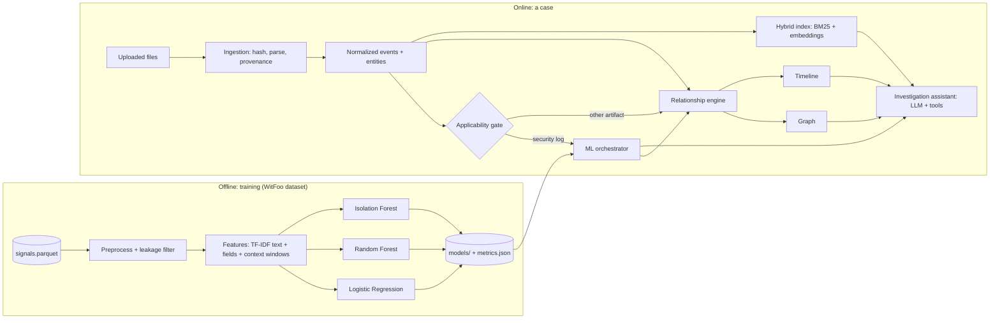

# Evidentia AI: Architecture & Implementation Plan

This plan is based on the measured findings in [reports/DATASET_AUDIT.md](../reports/DATASET_AUDIT.md). It is sized for CT-264 (Programming for AI, CCA) and a 16 GB, CPU-only Windows laptop.

## 1. Problem statement

**Problem:** Security teams receive millions of log events. Rules flag about 5% of them, and only a small fraction of those turn into real incidents. Analysts cannot inspect every alert.

**Inputs:** security log events (fields + raw message) and, for a case, uploaded evidence files.

**Outputs:**

1. A class for each event (benign / suspicious / malicious) with probabilities.
2. An anomaly score.
3. Related evidence and a timeline.
4. Grounded answers to investigator questions.

**Why it counts as "intelligent":**

- Learned from 2M real SOC events.
- Uses behavioral context (time + entities), not just keywords.
- Combines supervised and unsupervised models.
- Explains its predictions.
- A RAG assistant reasons over the case evidence and the ML outputs, and cites both.

## 2. System overview



## 3. ML design

### Task: hierarchical 3-class

| Stage | Question | Data | Note |
|---|---|---|---|
| 1 | Benign vs alert (suspicious ∪ malicious) | all orgs | Mostly log-source recognition. Reported together with an ablation. |
| 2 | Suspicious vs malicious (escalation) | non-benign rows of ORG-0004 / ORG-0005 | The substantive task. Text is ambiguous for 62% of malicious rows, so context features are essential. |

Final 3-class probabilities are combined from the two stages:

- P(benign) = 1 − p₁
- P(suspicious) = p₁(1 − p₂)
- P(malicious) = p₁p₂

A **flat 3-class** model is also trained as a comparison. This gives the "alternative strategies" the rubric asks for.

### Features (only fields that are available at prediction time)

- **Text:** `message_sanitized` with digits masked → TF-IDF (word 1–2-grams + char 3–5-grams). Kept sparse.
- **Categorical:** `message_type`, `action`, `protocol`, `severity`, port buckets → one-hot encoding.
- **Context (past-only windows; no future rows):** per `src_ip` / `dst_ip` / `dst_port`, computed over the previous 1, 10 and 60 minutes:
  - event counts
  - distinct destinations and ports
  - seconds since the previous event
- **Excluded:** every column in audit §5.2. The columns in §5.3 are used only in the ablation.

### Models

- Logistic Regression (`class_weight="balanced"`, C tuned).
- Random Forest (`class_weight="balanced_subsample"`; tuned with GridSearch on depth, leaves and feature count).
- Isolation Forest on context + categorical features, scored separately from the classifiers and never merged into class probabilities. Its threshold is chosen on validation data at a fixed alert budget (for example, the top 1%).
- **ML orchestrator** returns, for each event:
  - each model's prediction and probabilities
  - the anomaly score
  - a disagreement flag
  - the model and pipeline version

### Evaluation (no random splits)

| Split | Train | Test | Purpose |
|---|---|---|---|
| **A: temporal, ORG-0004** | before 2024-07-29 20:00 UTC (1,063 malicious) | after it (3,113 malicious, 44 new incidents) | Unseen future + unseen incidents |
| **B: temporal, ORG-0005** | 26 Jul UTC (2,518 malicious after dropping cross-cut incidents) | 27 Jul UTC (882 malicious) | Second org, same protocol |
| **POOLED** | A train ∪ B train | A test ∪ B test | Deployed model |
| **C: cross-org** | ORG-0004 | ORG-0005 (and the reverse) | Stress test: do behavioral features transfer when text cannot? |

Additional rules:

- Incidents that cross a split boundary go entirely to the test side, so no incident appears in both.
- Hyperparameters are chosen by grouped CV *inside* the training window. The test day is touched once.
- Every encoder, vectorizer and scaler is fitted inside a scikit-learn `Pipeline` on training data only.

**Metrics:**

- macro-F1
- per-class precision and recall
- confusion matrix
- PR-AUC (malicious)
- training and inference time
- model size
- results on the **novel-text subset**: test rows whose exact text never appeared in training

**Ablations:**

- text-only, context-only, and text + context
- with and without source fields
- with and without `incident_signals`

## 4. Evidence ingestion (case side)

- Supported formats: JSON, CSV, TXT, LOG, HTML first; OCR for images later (optional).
- For each file:
  - store the SHA-256 hash, size and upload time
  - keep the original read-only under `cases/<id>/original/`
  - write normalized records separately
  - give every extracted item a provenance pointer `(file, line/row/offset)`
- Timestamps are parsed with an explicit timezone. When a value is missing, it stays `null` with `time_quality="missing"`; it is never invented.
- Entities are extracted with regex plus validation: IPv4/IPv6, domains, URLs, emails, usernames, `HOST-/USER-` tokens, file paths, hashes and ports.
- **Applicability gate:** the classifier runs only on records that map onto the training schema (firewall or flow-style security events). Every other record gets "ML not applicable".

## 5. Relationship engine (research question)

Pairwise signals between events/artifacts:

- **Temporal:** exp(−Δt / τ).
- **Entity:** weighted Jaccard over shared indicators (rare entities weigh more, using IDF).
- **Semantic:** cosine similarity of `all-MiniLM-L6-v2` embeddings.

**Combined score:** a logistic regression *learned* on labeled pairs, so the weights are not hand-picked.

**Ground truth:** two malicious rows are related if they share an `incident_id`.

**Experiment:** for each query event, rank its candidates within the same org and ±N hours, then compare temporal-only, entity-only, semantic-only and combined scoring using P@K, R@K and MRR. The circularity caveat from audit §8 must be stated with the results.

Each edge stores its type, score, the per-signal breakdown and its source artifacts. The graph is built with NetworkX.

## 6. RAG investigation assistant

- **Retrieval:**
  - case evidence chunks indexed with **hybrid search**: BM25 for exact IPs, users and hashes, plus embeddings for meaning
  - a separate small knowledge index holding the rule catalog (261 rules), a few attack reports and MITRE technique notes
- **Tools the LLM can call:**
  - `search_evidence`
  - `timeline_query(start, end, entity)`
  - `graph_neighbors(node)`
  - `ml_result(event_id)`
  - `artifact_metadata(id)`
- **Grounding:** every case fact in an answer must cite an event or chunk ID. The answer separates evidence, model prediction, inferred relationship and unknown. If nothing relevant is retrieved, it says so.
- **Case isolation:** every query is filtered by `case_id`.
- **LLM (as built):** Google Gemini (`GEMINI_MODEL`, default `gemini-3.8-flash`) when `GEMINI_API_KEY` is set. Only the retrieved records for a question are sent, and the UI says so. Without a key, a built-in answerer assembles the same sections from the retrieved records. The original plan was local Ollama; Ollama is not installed on the development laptop.

## 7. Stack and layout

Planned stack (as built: Python 3.14, FastAPI, React + Vite, SQLite per case, fastembed, Gemini; see README):

- pandas, DuckDB/Parquet
- scikit-learn, joblib
- sentence-transformers, rank-bm25, FAISS (or NumPy)
- NetworkX
- Ollama
- Streamlit (UI)
- SQLite (cases, events)
- pytest

FastAPI and React are *future work*. They are not needed for the CCA.

> The machine currently has Python 3.14. The audit/EDA environment (`.venv`) works on it. Before Phase 4, check that `torch` / `sentence-transformers` install on 3.14; if they do not, switch to 3.12.

```
evidentia/
  ingestion/   upload.py (CSV/JSON/log/text/HTML, SHA-256, provenance, column mapping), entities.py
  ml/          config, data, features, context, models, evaluate, orchestrator
  cases/       store.py (cases/<id>: read-only originals + SQLite), pipeline.py (per-file processing)
  relations/   mapper.py (candidates, signals, learned non-negative weights, evidence gate)
  rag/         embed.py (fastembed MiniLM), retrieve.py (facts, filters, BM25 + dense, links, knowledge),
               llm.py (Gemini / built-in), answer.py (sections, citations, check)
  api/         main.py (FastAPI; serves frontend/dist)
frontend/      React + TypeScript (Vite): Cases, Overview, Evidence, Records, Connections, Ask, Model, Data, About
scripts/       audit, EDA, training, results figures, stage1_within_product, train_relations, report appendix
reports/       DATASET_AUDIT.md, ML_RESULTS.md, ML_REPORT.md, figures/, metrics/
tests/         test_ml.py, test_api.py
data/          raw/ (dataset, git-ignored), samples/ (labelled sample case files), models_cache/ (embeddings, git-ignored)
```

## 8. Mapping to the CT-264 rubric

| Rubric item | Where it is satisfied |
|---|---|
| Problem identification (inputs/outputs) | §1 above + report introduction |
| Problem solving (alternative strategies) | hierarchical vs flat models; LR vs RF vs IF; ablations |
| Preprocessing / missing values / imbalance | audit §5–6; class weights; imputation; dedup handling |
| EDA with visualizations | `reports/figures/` (12 charts) |
| Model + evaluation + improvement | §3: GridSearch tuning, ensemble RF, macro-F1 and PR-AUC |
| Visualization / interface | Streamlit app |
| External API | local LLM via Ollama: purpose and integration explained |
| Privacy / ethics | sanitized dataset, local LLM, read-only evidence, honest label limitations |
| 10-page report with diagram | Phase 7; diagrams in §2 |

## 9. Phases

| # | Phase | Output | Priority | Status (2026-11-10) |
|---|---|---|---|---|
| 1 | Dataset audit + EDA | `reports/DATASET_AUDIT.md`, 12 audit figures, `notebooks/01_eda.ipynb` (9 figures) | Core | ✅ Done |
| 2 | ML pipeline: features, context windows, splits, LR/RF/IF, tuning, ablations | `models/`, `reports/metrics/*.json`, tests | **Core: marks come from here** | ✅ Done (train-score check pending) |
| 3 | App v1 (Streamlit), replaced in v2 by React + FastAPI | working demo | Core | ✅ Done (v2) |
| 4 | Ingestion for the other formats + entities + timeline | case pipeline | Bonus | ✅ Cases, CSV/JSON/log/text/HTML, indicators, case-wide activity chart (no OCR) |
| 5 | Relationship engine + graph + research experiment | P@K results | Bonus | ✅ `evidentia/relations/`, `reports/metrics/relations.json` |
| 6 | RAG assistant with tools and citations | chat page | Bonus | ✅ `evidentia/rag/` (Gemini or built-in; no evaluation set yet) |
| 7 | Technical report (10+ pages) + viva preparation | PDF | Core | ⏳ `reports/ML_REPORT.md` written; PDF not yet |

The current state, with known issues, is in [docs/PROJECT_STATUS.md](PROJECT_STATUS.md).

Phases 1–3 plus 7 already form a complete CCA submission. Phases 4–6 build on it.
