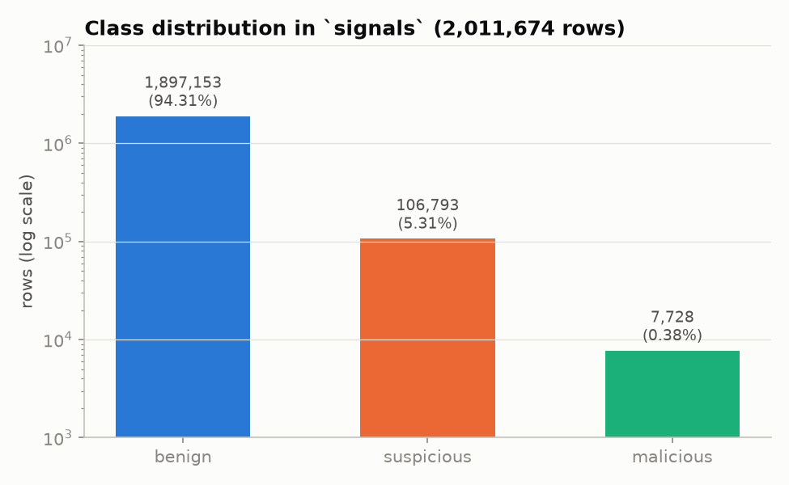
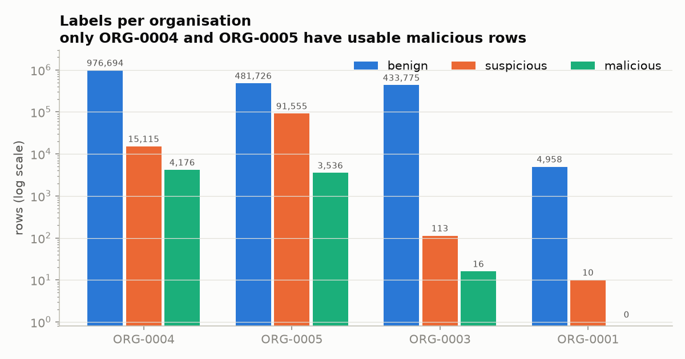
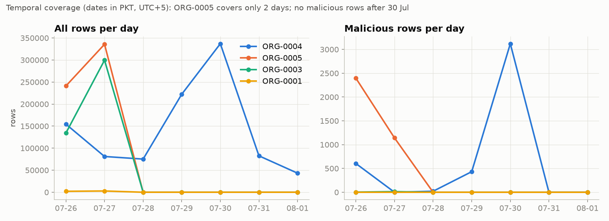
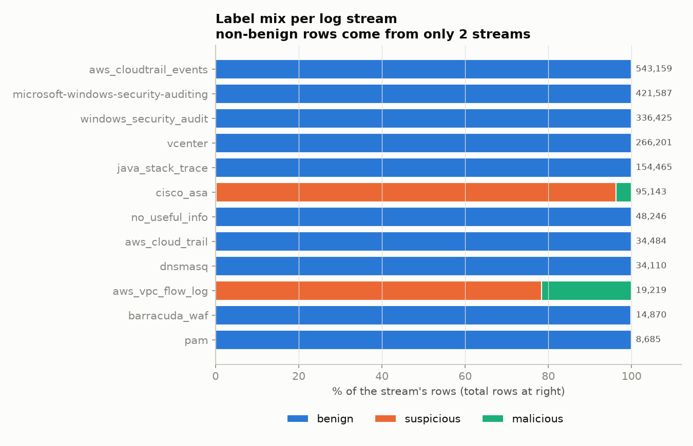
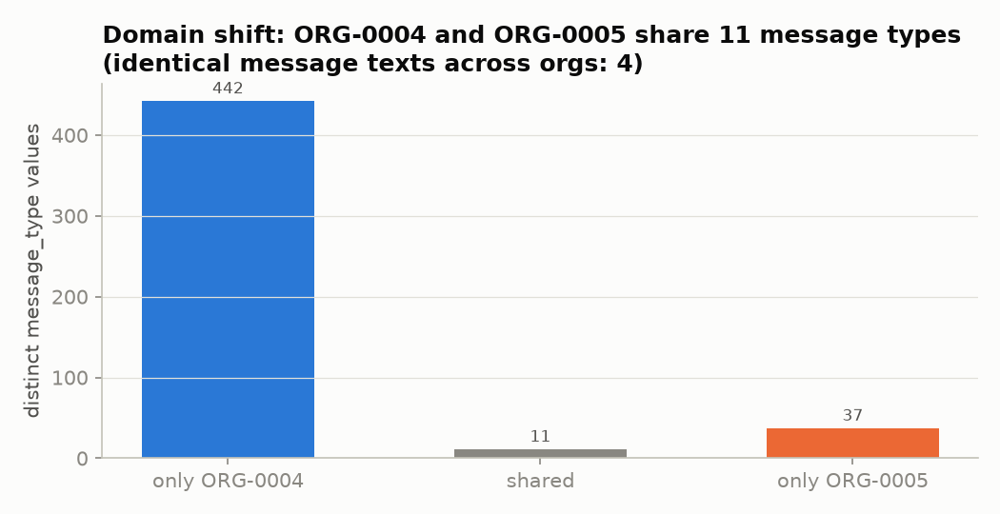
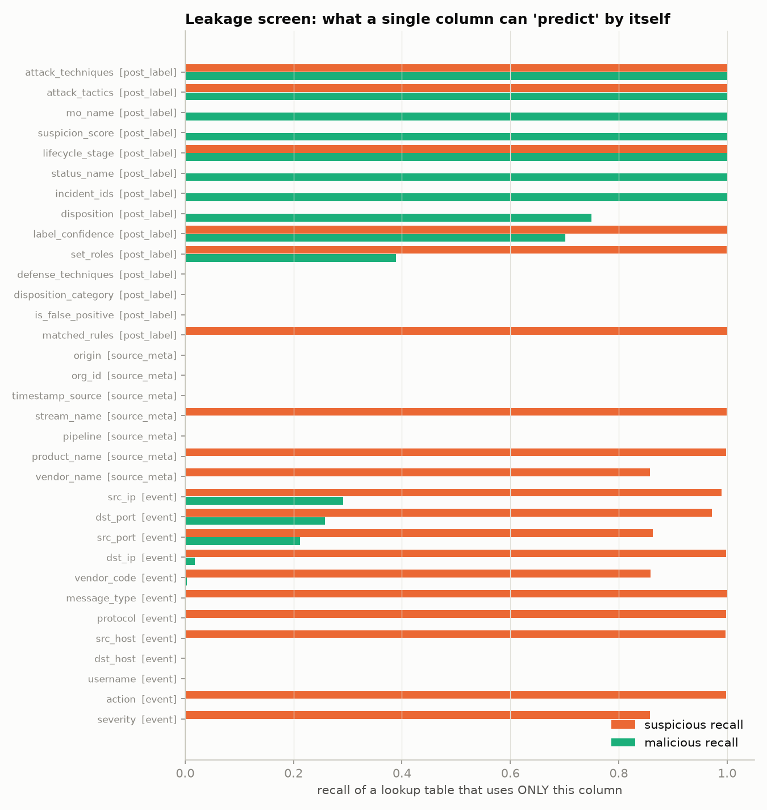
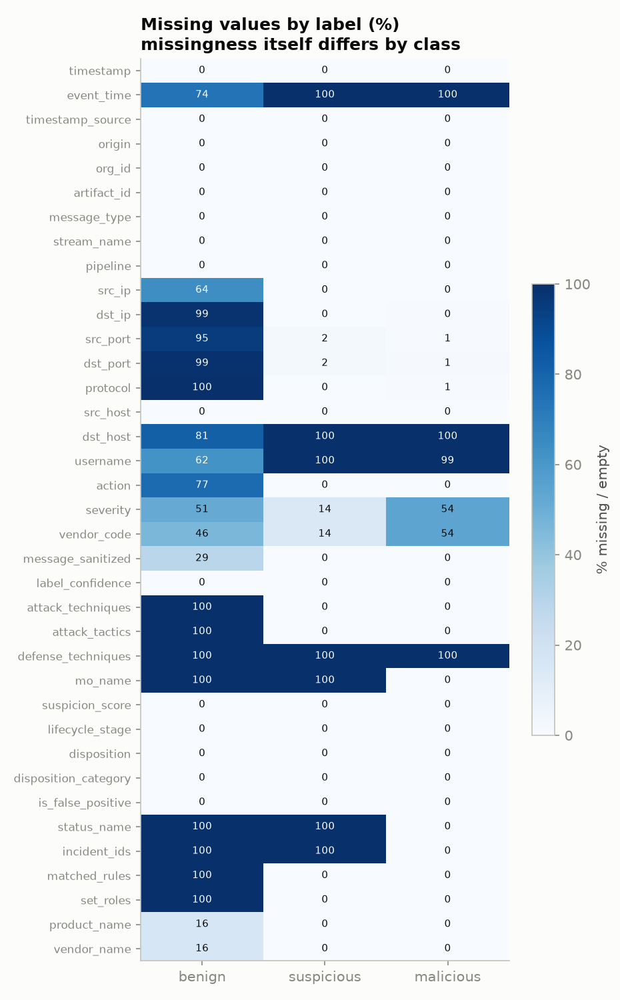
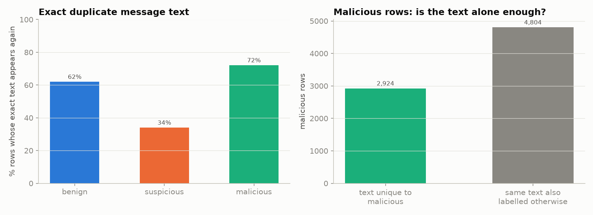
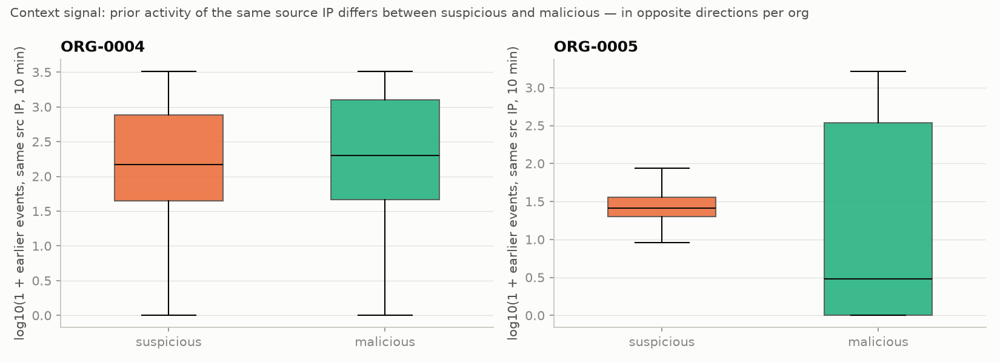
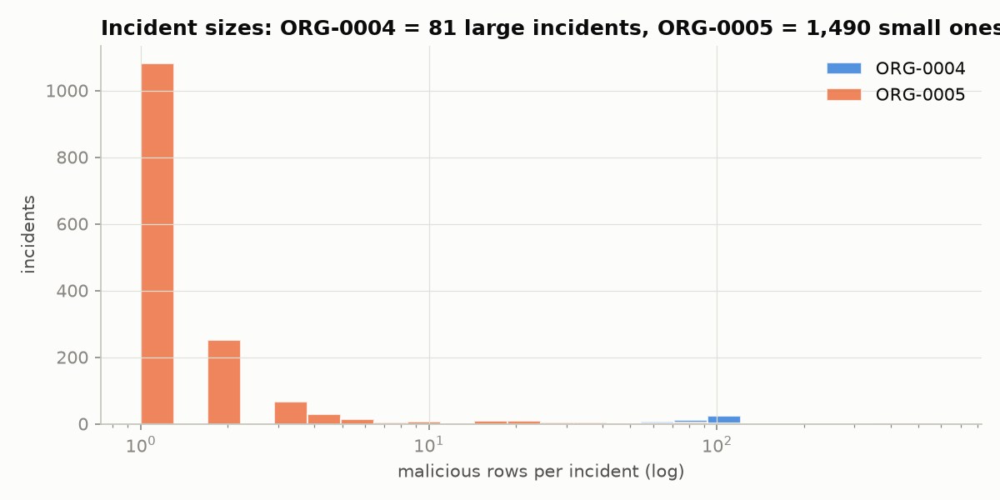

# Evidentia AI: Phase 1 Dataset Audit

**Dataset:** `witfoo/precinct6-cybersecurity` v2.1.0 (Hugging Face), downloaded 2026-11-09
**Reproduce:** `.venv/Scripts/python scripts/audit_dataset.py` → `reports/audit_results.json`; `.venv/Scripts/python scripts/eda_figures.py` → `reports/figures/`

Each finding carries one of these tags:

- **[Verified]:** measured by the scripts above.
- **[Card]:** stated in the dataset card (`data/raw/precinct6/README.md`) but not independently re-measured.
- **[Inferred]:** a reasoned conclusion that has not been tested yet.
- **[Not yet verified]:** needs a Phase 3 experiment.

---

## 1. What was downloaded

| Subset | File | Rows | Used for |
|---|---|---|---|
| `signals` | `signals/signals.parquet` (117 MB) | 2,011,674 [Verified] | ML training + evaluation |
| `incident_signals` | `signals/incident_signals.parquet` | 238,511 [Verified] | Excluded from main training (see §5.4) |
| `attack_reports` | `graph/attack_reports.parquet` | 51,371 [Verified] | RAG example corpus (limited, see §8) |
| `graph_edges` | `graph/edges-00000.parquet` | 1,740,438 [Verified] | Relationship ground truth (`INCIDENT_LINK`) |
| `graph_nodes` | `graph/nodes.parquet` | 47,585 [Verified] | Entity reference |
| rule catalog | `reference/lead_rules_catalog.json` | 261 rules [Card] | RAG knowledge: explains *why* an event is suspicious |

The large `incidents.jsonl` (4.5 GB) and `graph.graphml` (1.4 GB) files were not downloaded. They are not needed for the planned tasks.

## 2. Labels

`label_binary` takes three values. In `signals` the split is [Verified]:

| Label | Rows | Share |
|---|---|---|
| benign | 1,897,153 | 94.31% |
| suspicious | 106,793 | 5.31% |
| malicious | 7,728 | **0.38%** |

**What the labels mean [Card]:**

- `suspicious`: the event matched one of WitFoo's 261 detection rules.
- `malicious`: the event became a *lead* of an incident in WitFoo's automated correlation engine.
- `benign`: neither of the above.

There is **no analyst-verified ground truth**. A model trained on these labels learns to reproduce WitFoo's automated triage. It does not learn true maliciousness.

**Rule behind the labels [Verified]:** 99.8% of suspicious rows and 99.5% of malicious rows carry the single rule `"Blocked Action"`. So "suspicious" here essentially means *a firewall or flow-log block event*.

**Attack type [Verified]:** every malicious row has `mo_name = "Data Theft"`. A multi-class attack-type task is therefore **unsupported by the data**.

## 3. Organizations and time

| Org | Rows | Suspicious | Malicious | Calendar dates (UTC) | Actual span (first → last row) |
|---|---|---|---|---|---|
| ORG-0004 | 995,985 | 15,115 | 4,176 | 26 Jul – 1 Aug (7 dates) | **5.78 days** |
| ORG-0005 | 576,817 | 91,555 | 3,536 | 26–27 Jul (2 dates) | **0.78 days** |
| ORG-0003 | 433,904 | 113 | 16 | 26–27 Jul (2 dates) | 0.78 days |
| ORG-0001 | 4,968 | 10 | 0 | 26–27 Jul (2 dates) | 0.78 days |

*Corrected after the EDA notebook run.* An earlier version of this table said "7" and "2" days; those were counts of calendar dates. The actual time spans above are printed by `notebooks/01_eda.ipynb` (§0).

[Verified] Only ORG-0004 and ORG-0005 have enough malicious rows to train or test on.

[Verified] No malicious row occurs after 30 Jul. A naive "last day" temporal test set would contain zero malicious rows.

## 4. Where the minority classes come from: the most important finding

[Verified] Non-benign rows come from essentially two log streams, and each stream belongs to **one organization only**:

| Stream | Org | Benign | Suspicious | Malicious |
|---|---|---|---|---|
| `aws_vpc_flow_log` | ORG-0004 only | **0** | 15,063 | 4,156 |
| `cisco_asa` | ORG-0005 only | 81 | 91,537 | 3,525 |

Three consequences follow:

1. **Benign vs non-benign is almost fully determined by the log source.** A lookup on `stream_name` alone reaches 99.9% suspicious recall (figure 08). Any "benign/suspicious" accuracy is therefore mostly *source-type recognition*. It must be reported with a source-field ablation, not presented as threat detection. [Verified]
2. **The real problem is suspicious vs malicious.** It happens *inside* the same stream, among events that matched the same rule. [Verified]
3. **Cross-organization generalization is structurally hard.** ORG-0004's malicious events are AWS flow logs and ORG-0005's are Cisco ASA firewall logs. The two orgs share only 11 of 490 `message_type` values, and only 4 message texts appear in both orgs. A text-based model trained on one org has never seen the other's log format. [Verified]

## 5. Leakage analysis

### 5.1 Single-column leakage screen [Verified]

For each column, a lookup table was built that predicts the majority label for each value of that column. A recall near 1.0 from a single column signals a shortcut.

### 5.2 Columns to exclude (label is derived from them, or they are derived from the label)

| Column | Evidence | Decision |
|---|---|---|
| `attack_techniques`, `attack_tactics` | Recall 1.0 for both minority classes; empty for all benign rows | **Exclude** |
| `mo_name`, `suspicion_score`, `status_name`, `incident_ids` | Malicious recall 1.0; populated only for malicious rows | **Exclude** |
| `matched_rules`, `set_roles` | Suspicious recall 1.0; this is the rule output itself | **Exclude** |
| `lifecycle_stage`, `label_confidence` | Recall ≈ 1.0; derived from label formulas (card §Scoring) | **Exclude** |
| `disposition`, `disposition_category`, `is_false_positive` | Post-incident engine status | **Exclude** |
| `defense_techniques` | Always empty | Drop (no information) |

### 5.3 Source / collection-path columns (shortcut risk; use only inside an ablation)

| Column | Finding | Decision |
|---|---|---|
| `stream_name`, `product_name`, `vendor_name`, `pipeline` | `stream_name` → 99.9% suspicious recall | Main model excludes them. The ablation adds them back and reports the gain. |
| `org_id` | Defines the evaluation groups | Never a feature |
| `origin`, `timestamp_source` | Constant in `signals`, but perfectly separate `signals` from `incident_signals` | Never a feature |
| `artifact_id` | Unique ID | Never a feature |

### 5.4 Why `incident_signals` is excluded from main training [Verified]

- 100% of its rows are malicious, and its `timestamp_source` is `lead.observed_at` (vs `artifact.timeuuid` in `signals`).
- It spans 2022–2024 and is 93% `cisco_asa`. 58% of it comes from ORG-0001, which has **zero** malicious rows in the live capture.

Mixing it in teaches the model "old record / this format = malicious". It may be used only in a documented ablation.

### 5.5 Missingness is class-dependent [Verified]

| Field | Empty in benign | Empty in suspicious / malicious |
|---|---|---|
| `message_sanitized` | 28.7% | 0% |
| `src_ip` | 64% | 0% |
| `username` | 62% | 99.9% / 99.4% |

Missing-value indicators therefore encode the log source as well. The pipeline will impute them, but their contribution is part of the source ablation.

## 6. Duplicates and label conflicts

- [Verified] 54.6% of all rows repeat an exact message text that appears elsewhere. The table has 913,954 distinct texts among 2.01M rows.
- [Verified] **4,804 of 7,728 malicious rows (62%) have message text identical to rows labeled otherwise.** For these rows, no model that reads only the single row can be correct on all of them. Whether an event is malicious depends on what *else* happened around it, which is exactly what WitFoo's correlation engine looks at.
- [Verified] After masking digits, malicious rows reduce to just **48 text templates** and suspicious rows to 102. A random split would place the same templates in both train and test, which inflates the scores.

**Consequences:**

- Evaluation must report results on test rows whose text was *never seen in training*.
- Splits must be grouped by time and incident, never random.
- **Context features** (see §7) are needed to separate suspicious from malicious.

## 7. Context signal (motivates the ML design)

[Verified] The number of events from the same source IP in the preceding 10 minutes differs between suspicious and malicious rows:

- **ORG-0004:** malicious median 200 vs suspicious 147.
- **ORG-0005:** malicious median 2 vs suspicious 25.

The direction is **opposite** in the two organizations.

- [Inferred] Behavioral context carries signal, but the pattern is organization-specific. A single model is unlikely to transfer across orgs without retraining.
- [Not yet verified] How much context features improve over text-only features is measured in Phase 3.

Incident structure [Verified]:

- **ORG-0004:** 81 incidents, median 98 malicious rows each.
- **ORG-0005:** 1,490 incidents, median 14 rows each.
- 600 malicious rows belong to more than one incident.
- No incident spans two organizations.

## 8. Other subsets

- **`attack_reports` [Verified]:** 51,371 reports with median length 1,136 characters. 51,370 of them are "Data Theft". They are generated deterministically from a template (see the card). Their value as diverse knowledge is low, so a handful will serve as RAG examples rather than as the main knowledge base.
- **`graph_edges` [Verified]:** 335,645 `INCIDENT_LINK` edges. Malicious rows that share an incident ID give a **ground truth for "related evidence"**.
  - Caveat [Inferred]: WitFoo built those incidents partly from shared hosts and time. Entity-based and temporal relationship scores will therefore look favorable against this ground truth. This circularity must be stated in the report.
- **Timestamps [Verified]:**
  - `timestamp` is ingest time, with a median lag of about 9.6 s behind the device's `event_time`.
  - `event_time` is present for only 26% of benign rows and about 0% of suspicious/malicious rows. Timelines will therefore use `timestamp` and label it "ingest time".

## 9. Verdict: what the data supports

| Intended task | Verdict |
|---|---|
| 3-class benign / suspicious / malicious | **Supported, with reframing.** Implement it as a two-stage classifier: (1) benign vs alert, (2) suspicious vs malicious. Stage 1 is mostly source recognition and is reported as such. Stage 2 is the substantive task. A flat 3-class model is trained as a comparison. |
| Logistic Regression vs Random Forest on the same features and splits | Supported |
| Isolation Forest | **Feasible** on context features. Whether anomaly scores rank malicious rows above suspicious ones is measured, not assumed (PR-AUC). [Not yet verified] |
| "Unseen data" generalization | Within an organization, held out by future time and by unseen incidents: **supported**. Cut-offs are in UTC. Malicious rows arrive in bursts, so a calendar-day split does not work for ORG-0004. ORG-0004 uses 2024-07-29 20:00 UTC: train has 1,063 malicious rows in 37 incidents, test has 3,113 in 44 incidents, and 0 incidents cross the cut-off. ORG-0005 uses 2024-07-27 00:00 UTC: train has 2,654 malicious rows, test has 882, and 44 incidents cross the cut-off; their training-side rows (137) are dropped. (Figure 03 uses PKT dates, so its day boundaries differ from these UTC cut-offs.) |
| Cross-organization generalization | **Testable but expected to fail** for text features, because the orgs use different products. Running it is still worthwhile: whether *behavioral* features transfer when text does not is a genuine research result. |
| Attack-type classification | **Unsupported**: there is only one `mo_name`. |
| Relationship evaluation with ground truth | **Supported** via shared `incident_ids`, with the circularity caveat. |
| Browser history / screenshots / HTML forensics | **Unsupported by this dataset.** These parsers are tested on separately prepared sample files and get no ML classifier. |
