# Evidentia AI: Complete Machine-Learning Report

**Course:** CT-264 Programming for AI (CCA), NED University
**Project:** AI-assisted security-log triage for digital forensics
**Dataset:** WitFoo Precinct6 cybersecurity dataset, v2.1.0 (Hugging Face `witfoo/precinct6-cybersecurity`)
**Repository:** https://github.com/Maaz-Ali0102/evidentia-ai

This file brings the whole ML work into one place: problem, data, audit, EDA, preprocessing, features, models, tuning, results, the web interface, limitations and reproduction. Appendix A holds every raw metric, Appendix B raw data rows, and Appendix C the complete training log.

**Where the numbers come from.** Every number is produced by code in this repository:

- Sections 1–10 quote the reports `DATASET_AUDIT.md`, `eda_summary.md` and `ML_RESULTS.md`.
- Appendices A–C are generated by `scripts/build_report_appendix.py` straight from `reports/metrics/*.json`, `models/registry.json` and `data/samples/`.

---

## Contents

1. Problem statement
2. System architecture
3. The dataset
4. Data audit and leakage analysis
5. Exploratory data analysis (EDA)
6. Preprocessing and feature engineering
7. Evaluation design (splits, imbalance, metrics)
8. Models and tuning
9. Results
10. The application (interface)
11. Answers to the key questions
12. Limitations and ethics
13. Reproduction
14. Rubric mapping

Appendix A: raw metrics · Appendix B: raw data examples · Appendix C: training log

---

## 1. Problem statement

**Problem.** Security teams receive millions of log events per day. Rule engines flag about 5% of them, and only a small fraction of those become real incidents, so analysts cannot inspect every alert.

**Goal.** Given a security log file, classify every event as **benign**, **suspicious** or **malicious**, add an independent anomaly score, and show the investigator which events to look at first, with provenance back to the original line.

| | |
|---|---|
| **Input** | Security log events: a timestamp, the raw message, fields such as `message_type`, `action`, `protocol`, `severity`, IPs and ports. They arrive as a CSV, JSON or raw `.log` file. |
| **Output** | For each event: <br>• class + 3-class probabilities from two models (Logistic Regression and Random Forest)<br>• an Isolation Forest anomaly flag<br>• an applicability decision<br>• a model-agreement flag |
| **ML type** | Supervised classification (imbalanced, hierarchical) + unsupervised anomaly detection |

**Why it can be called "intelligent".**

- The models learn from about 2 million real security events.
- They use **behavioural context**: what the same IP or port did *before* this event, not just keywords.
- Supervised and unsupervised views are combined.
- The system refuses inputs it was not trained for instead of guessing.

The evidence for these claims, and their limits, is in §9 and §11.

---

## 2. System architecture

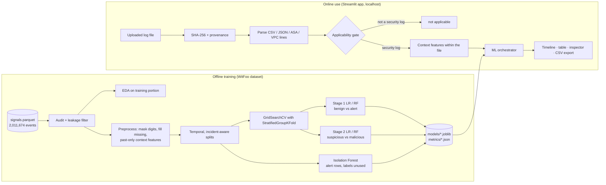

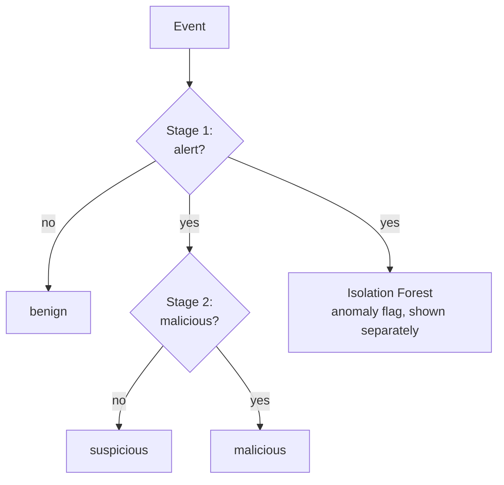

The 3-class probabilities are combined from the two stages:

- P(benign) = 1 − p₁
- P(suspicious) = p₁(1 − p₂)
- P(malicious) = p₁·p₂

Here p₁ = P(alert) and p₂ = P(malicious | alert).

**Code layout.**

| Path | Role |
|---|---|
| `evidentia/ml/config.py` | Paths, seed (42), labels, banned columns, cut-offs |
| `evidentia/ml/data.py` | Shared loader, dataset builder, splits |
| `evidentia/ml/context.py` | Past-only behavioural context features |
| `evidentia/ml/features.py` | Text masking, categorical preparation, `ColumnTransformer` |
| `evidentia/ml/models.py` | LR / RF / Isolation Forest factories |
| `evidentia/ml/evaluate.py` | Metric functions (every reported number) |
| `evidentia/ml/orchestrator.py` | Runs all models on new events |
| `evidentia/ingestion/upload.py` | File parsing, hashing, provenance |
| `scripts/` | Audit, EDA figures, training, results figures, checks |
| `app/` | Streamlit interface |
| `tests/test_ml.py` | 15 tests: leakage guards, split integrity, context correctness, persistence, orchestrator |

---

## 3. The dataset

**Source.** Anonymised live security telemetry from WitFoo Precinct (a SOC platform), published on Hugging Face. The `signals` table holds **2,011,674 events from 4 organisations**, captured 26 Jul – 1 Aug 2024. Because it is one large dataset, it satisfies the "one large dataset" option of the brief.

| Subset | Rows | Used for |
|---|---|---|
| `signals` | 2,011,674 | Training and evaluation |
| `incident_signals` | 238,511 | **Excluded** (leakage, see §4.4) |
| `attack_reports` | 51,371 | Not used by the ML (future RAG work) |
| `graph_edges` / `graph_nodes` | 1,740,438 / 47,585 | Not used by the ML |
| `lead_rules_catalog.json` | 261 rules | Background knowledge |

**Columns loaded for ML** (`evidentia/ml/data.py`): `artifact_id`, `org_id`, `timestamp`, `message_type`, `stream_name`, `product_name`, `vendor_name`, `pipeline`, `src_ip`, `dst_ip`, `src_port`, `dst_port`, `protocol`, `action`, `severity`, `message_sanitized`, `label_binary` and `incident_ids`. `incident_ids` is used only to build evaluation groups and is never a feature.

**Labels** (`label_binary`, full data):

| Label | Rows | Share | Meaning (dataset card) |
|---|---|---|---|
| benign | 1,897,153 | 94.31% | Matched no rule |
| suspicious | 106,793 | 5.31% | Matched one of WitFoo's 261 detection rules |
| malicious | 7,728 | **0.38%** | Became a *lead* of an incident in WitFoo's correlation engine |

> **Important.** These labels are WitFoo's **automated** triage, not analyst-verified ground truth. A model trained on them learns to reproduce that triage. Every malicious row has the same attack type (`mo_name = "Data Theft"`), so attack-type classification is impossible with this data.

**Organisations.**

| Org | Rows | Suspicious | Malicious | Actual time span |
|---|---|---|---|---|
| ORG-0004 | 995,985 | 15,115 | 4,176 | 5.78 days |
| ORG-0005 | 576,817 | 91,555 | 3,536 | 0.78 days |
| ORG-0003 | 433,904 | 113 | 16 | 0.78 days |
| ORG-0001 | 4,968 | 10 | 0 | 0.78 days |

Raw rows from the dataset are shown in **Appendix B**.

---

## 4. Data audit and leakage analysis

Script: `scripts/audit_dataset.py` → `reports/audit_results.json`. Full write-up: `reports/DATASET_AUDIT.md`.

### 4.1 Where the alerts come from

Non-benign rows come from essentially **two log streams, each owned by one organisation**:

| Stream | Org | Benign | Suspicious | Malicious |
|---|---|---|---|---|
| `aws_vpc_flow_log` | ORG-0004 only | 0 | 15,063 | 4,156 |
| `cisco_asa` | ORG-0005 only | 81 | 91,537 | 3,525 |

99.8% of suspicious rows and 99.5% of malicious rows carry the single rule "Blocked Action".

**Consequences.**

- Benign vs alert is mostly *log-type recognition* (confirmed in §9.1).
- The real problem is **suspicious vs malicious inside the same stream**.
- Cross-organisation transfer is structurally hard: the two orgs share only 11 of 490 `message_type` values.

### 4.2 Columns removed because they leak the label

A single-column lookup test found 14 columns that are produced by the labelling step itself. They are banned in code: `input_columns()` asserts that none of them can reach a model.

| Columns | Why |
|---|---|
| `attack_techniques`, `attack_tactics` | One-feature macro-F1 1.000; empty for every benign row |
| `mo_name`, `status_name`, `suspicion_score`, `incident_ids` | Populated only for malicious rows |
| `matched_rules`, `set_roles` | The rule output itself |
| `lifecycle_stage`, `label_confidence` | Derived from the label formulas |
| `disposition`, `disposition_category`, `is_false_positive`, `defense_techniques` | Post-incident engine status, or empty |

### 4.3 Columns kept out of the main models

- **Source fields** (`stream_name`, `product_name`, `vendor_name`, `pipeline`): `stream_name` alone gives 99.9% suspicious recall. They are used only in an ablation.
- **Identifiers** (`org_id`, `origin`, `timestamp_source`, `artifact_id`): never features.

### 4.4 Why `incident_signals` is excluded

All 238,511 of its rows are malicious, and they use a different timestamp source. The rows span 2022–2024, and 58% come from an org with zero malicious rows in the live capture. Mixing them in would teach "old record / this format = malicious".

### 4.5 Duplicates and conflicting labels

- 54.6% of rows repeat an exact message text found elsewhere.
- **4,804 of 7,728 malicious rows (62%) have exactly the same text as rows with another label.** No model that reads one row in isolation can classify all of them correctly. This is why **context features** are needed.
- After digit masking, malicious rows collapse to **48 templates** and suspicious rows to 102. A random split would therefore put the same templates in both train and test, which is why random splits are forbidden here.

### 4.6 Missing values depend on the class

| Field | Empty in benign | Empty in suspicious / malicious |
|---|---|---|
| `message_sanitized` | 28.7% | 0% |
| `src_ip` | 64% | 0% |

Missingness itself reveals the log source, which is another reason Stage 1 is easy.

---

## 5. Exploratory data analysis (EDA)

Notebook: `notebooks/01_eda.ipynb`. It executes top to bottom with 0 errors and writes 9 figures plus `reports/eda_summary.md`.

**Rules followed:**

- Every statistic that informs a modelling decision uses the **training portion only** (1,045,818 of 2,011,674 rows). The test portion appears only in the split chart.
- The random seed is fixed.
- Every number printed in the summary comes from executed code.

### Key findings

1. **Severe imbalance:** benign 94.62%, suspicious 5.03%, malicious **0.36%** (3,720 rows).
2. Only ORG-0004 and ORG-0005 have ≥ 500 malicious training rows.
3. **99.77%** of alert rows are `firewall_action` or `network_flow_data`, out of 470 message types.
4. **Malicious events are bursty:** 54.41% of malicious training rows fall in one hour of the day (11:00 UTC).
5. **Heavy duplication:**
   - 59.03% of malicious rows repeat an exact text.
   - They form only 37 digit-masked templates.
   - 40.70% share their text with rows of another label.
6. **Missingness is class-dependent:** the largest gaps are `protocol` 99.75%, `dst_ip` 97.95% and `dst_port` 97.20%.
7. **Post-label columns leak the label:** e.g. `attack_techniques` gives one-feature macro-F1 1.000, against an all-benign baseline of 0.325.
8. **Kept fields also encode the log type:** `dst_port` alone scores 0.733, because it is filled in for 1.45% of benign rows vs 97.78% of suspicious rows.

### Figures

| | |
|---|---|
| 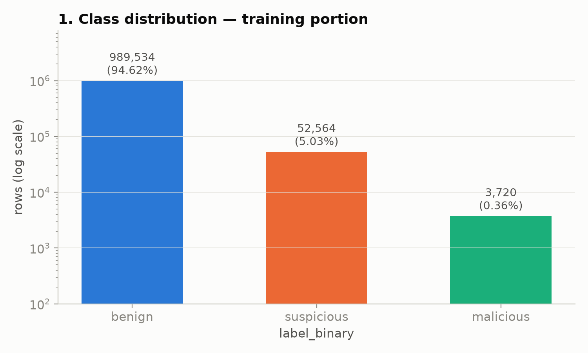 | 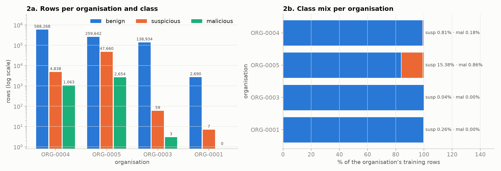 |
| Class imbalance | Class mix per organisation |
| 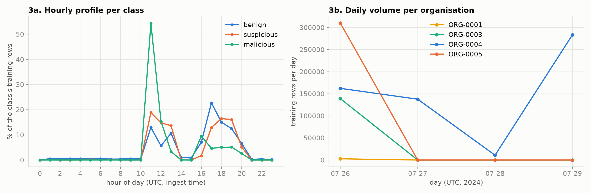 | 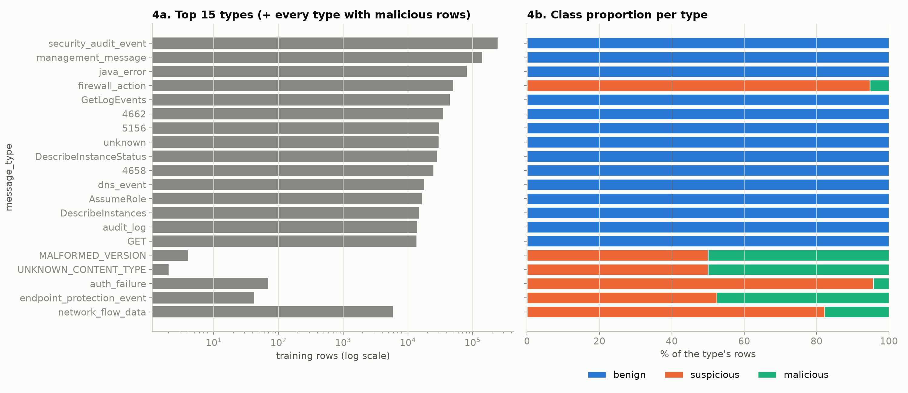 |
| Hourly / daily activity | Message types per class |
| 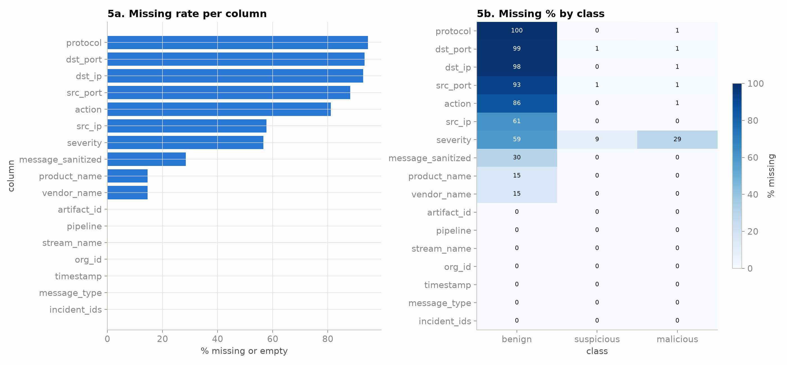 | 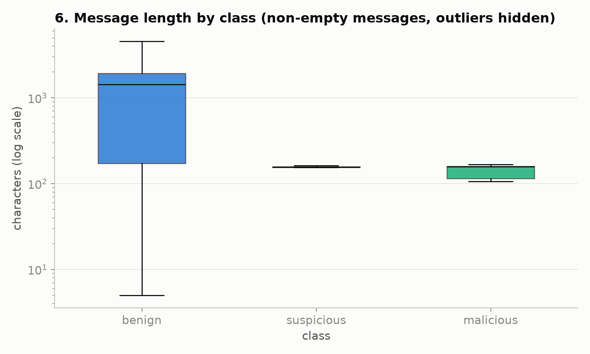 |
| Missing values per class | Message length |
| 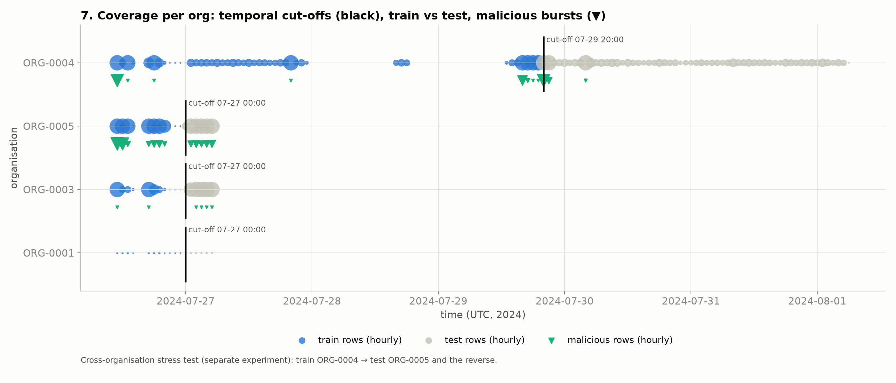 | 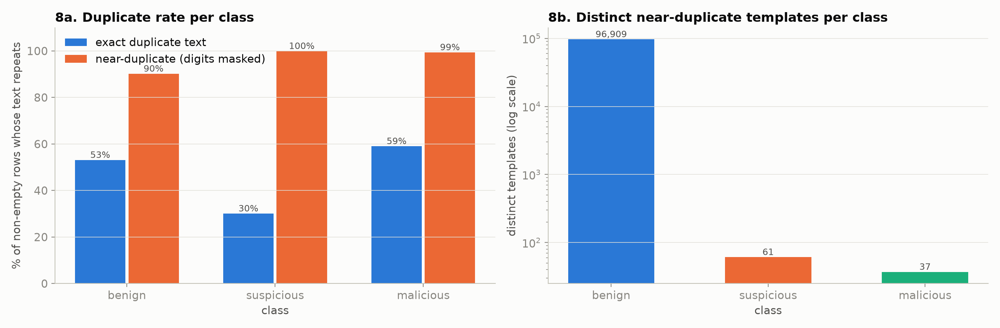 |
| Train / test split per org | Duplicates and conflicts |
| 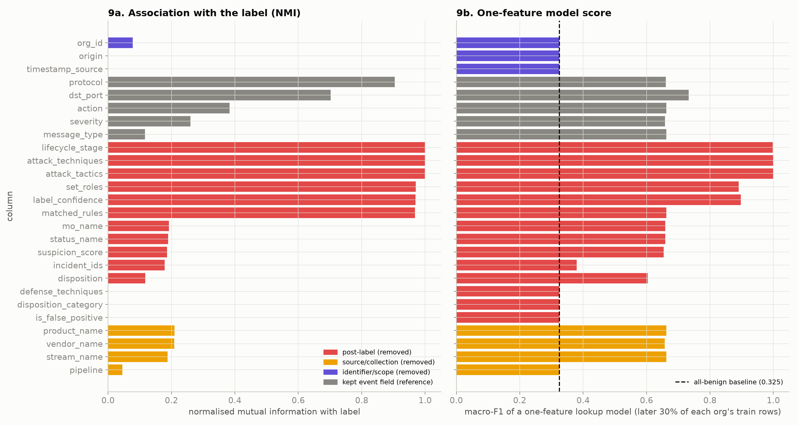 | |
| Leakage evidence per column | |

### Modelling decisions justified by the EDA

1. **Class weighting and imbalance-aware metrics** (not accuracy: predicting all-benign already scores 94.62%).
2. **Drop the 14 post-label columns.**
3. **Keep source fields and identifiers out of the main models;** test source fields only in an ablation.
4. **Temporal, incident-aware splits per organisation** plus cross-organisation tests; never random.
5. **Hierarchical task with behavioural context features.**

---

## 6. Preprocessing and feature engineering

Every learned transform is inside one scikit-learn `Pipeline` / `ColumnTransformer`, so it is fitted on training rows only and merely applied to validation and test rows. A unit test checks that the TF-IDF vocabulary comes from training rows only.

| Step | What is done | Why |
|---|---|---|
| Empty strings | Converted to missing (`NaN`) | Treat blanks and nulls the same way |
| Text | `message_sanitized` → every digit run replaced by `0` → TF-IDF, word 1–2-grams, `min_df=3`, max 20,000 features, sublinear TF | Timestamps and counters must not become vocabulary |
| Categorical | `message_type`, `action`, `protocol`, `severity`, `dst_port`, `src_port` bucket (well-known / registered / ephemeral / none); missing → `"none"`; one-hot, rare values (< 5) grouped | Handles unseen categories at prediction time |
| Context (23 features) | For each event, counts of **strictly earlier** events with the same source IP, destination IP, destination port, src→dst pair and src→port pair over 1 min / 10 min / 1 h / 6 h (20 features); seconds since the previous event from the same source IP; has-src-IP and has-dst-IP flags. log1p-scaled, then standardised. | The same text can be suspicious or malicious; behaviour around it differs. "Past-only" means no future leakage, verified by a brute-force unit test. |
| Missing values | Categorical → `"none"`; text → `""`; context → 0 counts plus the has-IP flags | Missingness is kept as information rather than invented |
| Imbalance | `class_weight="balanced"` (LR), `"balanced_subsample"` (RF); Stage 1 trains on all alerts + 250,000 sampled benign rows | Malicious is only 0.36% |
| Leakage guard | `input_columns()` raises an error if a banned or identifier column is requested | Leakage cannot happen silently |

Feature sets used in the ablations:

| Name | Contents |
|---|---|
| `text` | TF-IDF only |
| `context` | Categorical + context |
| `full` | Text + categorical + context |
| `full+source` | Full + source fields (ablation only) |

---

## 7. Evaluation design

### 7.1 Splits: future time, unseen incidents, never random

Cut-offs are set per organisation in UTC. Incidents that cross a cut-off are removed from training (137 rows), so **no incident appears on both sides**.

| Split | Train | Test | Purpose |
|---|---|---|---|
| A: ORG-0004 temporal | before 2024-07-29 20:00 (1,063 malicious, 37 incidents) | after (3,113 malicious, 44 new incidents) | Unseen future |
| B: ORG-0005 temporal | before 2024-07-27 00:00 (2,518 malicious) | after (882 malicious) | Second org |
| **POOLED** (deployed) | A train ∪ B train | A test ∪ B test | The model used in the app |
| C: cross-org | ORG-0004 → ORG-0005 and the reverse | | Stress test |

**Disclosure.** The cut-offs were placed by looking at *when* malicious rows occur, so that both sides contain incidents. This is a split-design decision, not tuning, but it did use label timing.

### 7.2 Train / validation / test

| Part | What it is |
|---|---|
| **Training** | Rows before the cut-off |
| **Validation** | `StratifiedGroupKFold(3)` *inside* the training window. Groups are the incident (malicious rows) or org + 2-hour block (other rows), so one attack is never split across folds. All choices — feature set, hyper-parameters and decision threshold — are made here. The threshold is the one that maximises F1 on out-of-fold training predictions. |
| **Test** | Rows after the cut-off, scored **once** |

### 7.3 Metrics

Accuracy is misleading at this imbalance, so the main metrics are:

- **PR-AUC** of the malicious / alert class, always shown next to its chance level (the positive rate).
- ROC-AUC.
- Macro-F1.
- Per-class precision and recall.
- Confusion matrices.
- **Incident-level recall:** the share of test incidents with at least one event flagged.
- Training time, inference time and model size.

---

## 8. Models and tuning

| Model | Configuration | Tuned with GridSearchCV (scoring = average precision) |
|---|---|---|
| Logistic Regression | `class_weight="balanced"`, liblinear (binary) / lbfgs (3-class), max_iter 3000 | Feature set ∈ {context, full} × C ∈ {0.1, 1, 10} |
| Random Forest (bagging ensemble) | `balanced_subsample`, `max_features="sqrt"`, 100–150 trees | Feature set ∈ {context, full} × max_depth ∈ {None, 20} × min_samples_leaf ∈ {1, 5} |
| Isolation Forest | 200 trees, max_samples 4096, context + categorical features, labels unused | Threshold = 99th percentile of training anomaly scores |

**Alternative strategies compared:**

- Hierarchical vs flat 3-class.
- LR vs RF vs Isolation Forest.
- Four feature-set ablations.
- With and without source fields.
- Within-org vs pooled vs cross-org.

**Selected models (POOLED).**

| Model | Selected by CV | Threshold |
|---|---|---|
| LR | context features, C = 0.1 | 0.8539 |
| RF | context features, max_depth 20, min_samples_leaf 5 | 0.8399 |

Every grid candidate and its CV score is listed in Appendix A.3.

**Effect of tuning (RF, CV PR-AUC).** Raising `min_samples_leaf` from 1 to 5 increased the score:

- POOLED: from 0.2072 to 0.3885.
- ORG-0005: from 0.2818 to 0.4814.

---

## 9. Results

### 9.1 Stage 1: benign vs alert

On 965,856 test rows (58,237 alerts), **every feature set scores ≈ 1.0**: full LR/RF, text-only, context-only and full+source.

**Why.** A follow-up check (`scripts/stage1_within_product.py`) showed that the label is a deterministic function of the event type:

- Of **607** (product, message_type) pairs in all 2,011,674 rows, **0** contain both benign and alert rows.
- A plain lookup table with no ML gets macro-F1 1.0. It misses only 4 alerts, all of an event type never seen in training.
- Training inside a single product (ASA, Windows AD, Barracuda WAF, Falcon) also gives 1.0.

**Conclusion.** Stage 1 is reported as a **deterministic router (log-type recognition), not threat detection**. The learning claim rests on Stage 2.

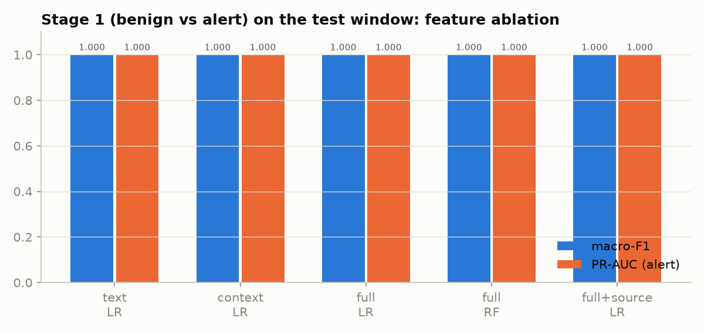

### 9.2 Stage 2: suspicious vs malicious (the real task)

**Tuned models:**

| Split | Model | CV PR-AUC | Test PR-AUC (chance) | Test ROC-AUC | Malicious P / R / F1 | Incidents detected |
|---|---|---|---|---|---|---|
| **POOLED** | LR | 0.4633 | **0.2502** (0.0687) | 0.8798 | 0.256 / 0.367 / 0.301 | 514 / 622 (82.6%) |
| **POOLED** | RF | 0.4076 | **0.2571** (0.0687) | 0.8458 | 0.344 / 0.181 / 0.237 | 545 / 622 (87.6%) |
| ORG-0005 | LR | 0.5296 | 0.3428 (0.0197) | 0.9550 | 0.359 / 0.417 / 0.386 | 301 / 578 (52.1%) |
| ORG-0005 | RF | 0.4814 | 0.3181 (0.0197) | 0.9598 | 0.350 / 0.762 / **0.479** | 520 / 578 (90.0%) |
| ORG-0004 | LR | 0.1560 | 0.2233 (0.2325) | 0.4648 | 0 / 0 / 0 | 0 / 44 |
| ORG-0004 | RF | 0.1678 | 0.2754 (0.2325) | 0.5561 | 0 / 0 / 0 | 0 / 44 |

**Feature ablation** (untuned, test PR-AUC):

| Split | Chance | text LR | context LR | full LR | full+source LR |
|---|---|---|---|---|---|
| ORG-0005 | 0.0197 | 0.2993 | **0.3415** | 0.3393 | – |
| POOLED | 0.0687 | 0.1336 | **0.2463** | 0.2025 | 0.2018 |
| Cross 0004→0005 | 0.0372 | 0.0384 | 0.1004 | 0.0716 | – |

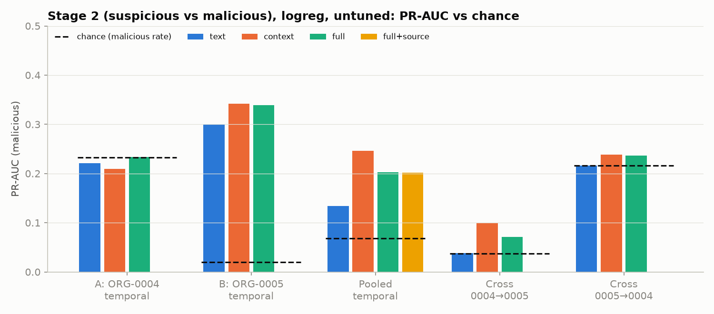
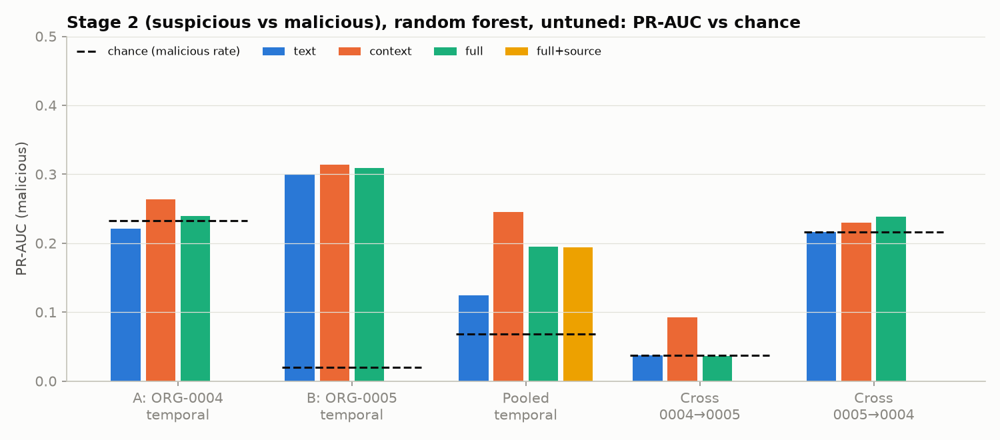

**What this shows:**

1. **ORG-0005 (future, unseen incidents): real but moderate signal.**
   - PR-AUC is about 17× chance and ROC-AUC ≈ 0.955.
   - The tuned RF touches 90% of test incidents.
   - Precision is about 0.35, so most flags still need an analyst.
2. **ORG-0004: no signal**, and the CV score (0.16) predicted that before the test was run.
3. **Cross-organisation transfer fails** (ROC-AUC 0.31–0.55), as the audit predicted, because the two orgs use different products.
4. **Behaviour beats text when organisations are mixed.**
   - POOLED text-only ROC-AUC is 0.416, worse than random.
   - Context-only reaches 0.878, and CV chose context-only features for the deployed models.
   - This is the main evidence that the models learn *behaviour*, not wording.
5. **Source fields add nothing in Stage 2:** 0.2025 vs 0.2018.

### 9.3 Three classes (benign / suspicious / malicious)

Test set: 965,856 rows (907,619 benign, 54,229 suspicious, 4,008 malicious).

| Strategy | Model | Accuracy | **Macro-F1** | Benign F1 | Suspicious F1 | Malicious P / R / F1 |
|---|---|---|---|---|---|---|
| Hierarchical | LR | 0.9929 | **0.7458** | 1.0 | 0.9357 | 0.255 / 0.369 / 0.302 |
| Hierarchical | RF | 0.9952 | 0.7313 | 1.0 | 0.9577 | 0.344 / 0.180 / 0.236 |
| Flat | LR | 0.9938 | 0.7254 | 1.0 | 0.9446 | 0.237 / 0.226 / 0.232 |
| Flat | RF | 0.9948 | 0.7317 | 1.0 | 0.9543 | 0.306 / 0.198 / 0.241 |

- **Best model:** the hierarchical LR, on both macro-F1 and malicious recall.
- **Accuracy (99%+) is not meaningful:** predicting all-benign already scores 94.0%.

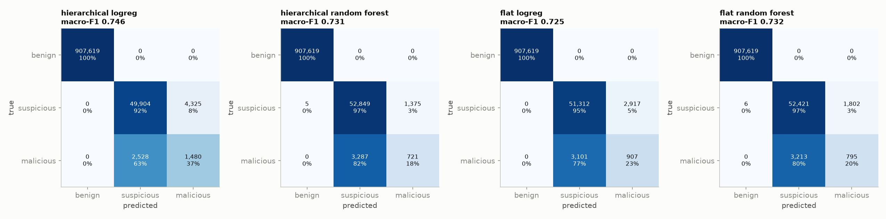

### 9.4 Isolation Forest (unsupervised)

| Experiment | PR-AUC (chance) | ROC-AUC |
|---|---|---|
| Malicious vs suspicious among alerts (labels unused) | 0.2594 (0.0687) | 0.8787 |
| Alert vs benign (fitted on benign rows only) | 0.9986 (0.0603) | 0.9998 |
| Malicious vs everything else | 0.1552 (0.0041) | 0.9765 |

**Findings:**

- Without labels, the Isolation Forest ranks malicious alerts about as well as the tuned supervised models.
- It catches **987 malicious rows that the RF misses**.
- The two detectors flag *no* malicious row in common. They are complementary, so the app shows both side by side instead of merging them.

### 9.5 Training vs validation vs test (over-fitting check)

| Model (POOLED) | Validation PR-AUC (CV) | Test PR-AUC | Chance |
|---|---|---|---|
| LR | 0.4633 | 0.2502 | 0.0687 |
| RF | 0.4076 | 0.2571 | 0.0687 |

**Training score: pending.** `scripts/train_val_test_scores.py` measures train, validation and test the same way, but it could not run on 10 Nov 2026: Windows Application Control blocked a pandas DLL. The result will appear in Appendix A.10 once it runs.

**Interpretation of the validation → test drop:**

- **Over-fitting is unlikely to be the main cause:**
  - CV picked the *simplest* options: 23 context features instead of 20,000 text features, the strongest regularisation (C = 0.1), and min_samples_leaf 5.
  - Folds are grouped by incident, so memorising an attack cannot inflate validation.
- **The drop is mainly temporal drift:**
  - Validation folds come from the same period as training, while the test is a *later* period with new incidents.
  - The malicious share is similar in both (6.4% vs 6.9%), so class mix does not explain the drop.
  - Picking the best of several grid candidates also makes the CV number slightly optimistic.
- **Rule for the pending check:** train ≫ validation would mean over-fitting; train ≈ validation would mean the drop is drift.

---

## 10. The application (interface)

A local **Streamlit** app (`app/`), run with `.venv/Scripts/python -m streamlit run app/streamlit_app.py`, on http://localhost:8501. Nothing is sent to external services.

| Page | Content |
|---|---|
| **Analyze logs** | Upload a CSV / JSON / JSONL / LOG / TXT file, or pick a sample from the "…or load a SAMPLE file" drop-down. Shows: <br>• the file's SHA-256 and the columns that were mapped<br>• an LR / RF switch and 6 summary metrics<br>• an alert timeline (UTC) with anomaly rings<br>• filters and an event table<br>• an event inspector with the full JSON output<br>• a WitFoo reference-label comparison (samples only)<br>• CSV download |
| **Model evaluation** | The tables and charts of §9, read live from `reports/metrics/*.json` |
| **Dataset & EDA** | The 9 EDA charts and the EDA summary |
| **About & limitations** | Pipeline, label meaning, measured limits, privacy |

### What happens on upload

1. The file is hashed (SHA-256) for chain of custody.
2. Each row or line becomes an event that keeps its file name and row number.
3. **Applicability gate.** An event is scored only if it has a timestamp and at least 30% of its word bigrams are in the training vocabulary (records without text need a known `message_type`). Notes, browser history and OCR text are marked *not applicable* instead of guessed.
4. Past-only context features are computed **within the uploaded file**.
5. LR and RF run through both stages, and the Isolation Forest scores the rows routed to the alert stage.

**Checks on the bundled samples.**

| Sample | Result |
|---|---|
| `witfoo_sample_ORG-0005_test_20min.csv` (17,363 test-window rows) | LR flagged 50 of 57 malicious rows, with 114 false positives |
| ASA `.log` file | 2,987 lines parsed as Cisco ASA |
| 5 non-security lines | All refused |

### Bugs found by testing and fixed

- The Isolation Forest first scored every row and flagged 14,378 of 17,363 sample rows. It now scores only alert-routed rows, and flags 2.
- The first applicability gate used single words and accepted a browser-history line. It now uses bigrams; a unit test covers this.
- The chart axis showed local time labelled as UTC. It is now a true UTC scale.

---

## 11. Answers to the key questions

**Does it work on unseen data?**

| Kind of unseen data | Result |
|---|---|
| Same organisation, future time window, new incidents (ORG-0005) | **Yes, partly:** ROC-AUC 0.955, PR-AUC about 17× chance, 90% of incidents touched |
| ORG-0004 future window | No |
| A different organisation | No (chance level) |
| Non-security text | Refused by design |

**Is "intelligent" justified?**

- **Partly, for a measurable reason:**
  - The deployed models chose behavioural context over text, and that is what generalises within an organisation.
  - The unsupervised detector adds an independent view that catches different malicious events.
  - The system knows when *not* to answer.
- **Limit:** malicious precision is only about 0.26–0.36, so it prioritises events for an analyst rather than replacing one.

**LR vs RF:**

- Similar ranking quality (PR-AUC 0.250 vs 0.257).
- LR has higher malicious recall and the best 3-class macro-F1 (0.746).
- LR is about 190× smaller (14 KB vs 2.7 MB) and about 4× faster.
- RF touches more incidents (87.6% vs 82.6%).

---

## 12. Limitations and ethics

**Limitations:**

- **Labels:** labels come from an automated engine, not analysts. "Malicious" means "resembles what WitFoo escalated", not "confirmed attack".
- **Data coverage:**
  - Short captures: three organisations cover about 0.78 days each, and ORG-0004 about 5.78 days. Each temporal test is essentially one burst pattern.
  - One attack type only ("Data Theft").
- **Model behaviour:**
  - Malicious precision is about 0.3: most flags need human review.
  - Probabilities are not calibrated (class-balanced training).
  - Validation PR-AUC is consistently above test PR-AUC (§9.5).
- **Method gaps:**
  - The cut-offs used label timing (disclosed).
  - Template overlap between train and test was not measured.
  - The training-score check is pending (§9.5).
  - The ablation that adds `incident_signals` was not run.
- **App:** in the app, context features only see the uploaded file's history, so the first minutes of a file have weaker scores.

**Ethics and privacy:**

- The dataset is published already pseudonymised.
- The app runs on `localhost`, keeps uploads in memory, does not store them and calls no external API.
- The limits above are shown inside the app (About page) so users do not over-trust the output.

---

## 13. Reproduction

```bash
python -m venv .venv
.venv/Scripts/python -m pip install -r requirements.txt
python -c "from huggingface_hub import snapshot_download; snapshot_download('witfoo/precinct6-cybersecurity', repo_type='dataset', local_dir='data/raw/precinct6', allow_patterns=['README.md','build/*.json','signals/*','graph/*.parquet','graph/metadata.json','reference/*'])"
.venv/Scripts/python scripts/audit_dataset.py
.venv/Scripts/python scripts/eda_figures.py
.venv/Scripts/python -m nbconvert --to notebook --execute --inplace notebooks/01_eda.ipynb
.venv/Scripts/python scripts/train_models.py            # ~77 min, 4-core i7-8550U, 16 GB RAM, no GPU
.venv/Scripts/python scripts/results_figures.py
.venv/Scripts/python scripts/stage1_within_product.py
.venv/Scripts/python scripts/train_val_test_scores.py
.venv/Scripts/python scripts/make_samples.py
.venv/Scripts/python -m pytest -q tests                 # 15 passed
.venv/Scripts/python scripts/build_report_appendix.py   # refreshes the appendix below
```

Fixed random seed: 42. Pinned package versions: `requirements.txt` (Python 3.14, pandas 3.1.1, numpy 2.5.4, scikit-learn 1.9.1, streamlit 1.67.0).

---

## 14. Rubric mapping (CT-264)

| Rubric item | Where |
|---|---|
| Problem identification, inputs / outputs, classification | §1, §2 |
| Large dataset | §3 (2,011,674 events) |
| Preprocessing, missing values, leakage | §4, §6 |
| EDA with visualisations | §5 (9 charts + 12 audit charts in `reports/figures/`) |
| Class imbalance handling | §6, §7.3 |
| Model + evaluation + tuning / ensembling | §7, §8, §9 (GridSearchCV, Random Forest ensemble, Isolation Forest, LR vs RF vs IF, hierarchical vs flat) |
| Visualisation / interface | §10 (Streamlit app) |
| Diagram | §2 (two diagrams) |
| Code explanation | §2 code layout, §6, §8, and docstrings in `evidentia/` |

---

<!-- APPENDIX:AUTO (everything below is generated by scripts/build_report_appendix.py) -->

## Appendix A. Raw metrics (generated from `reports/metrics/*.json`)

### A.1 Stage 2 split sizes

| Split | Train rows | Train malicious | Test rows | Test malicious |
|---|---|---|---|---|
| A_temporal_ORG-0004 | 5,901 | 1,063 | 13,390 | 3,113 |
| B_temporal_ORG-0005 | 50,178 | 2,518 | 44,777 | 882 |
| POOLED_temporal | 56,079 | 3,581 | 58,167 | 3,995 |
| C_cross_0004_to_0005 | 19,291 | 4,176 | 95,091 | 3,536 |
| C_cross_0005_to_0004 | 95,091 | 3,536 | 19,291 | 4,176 |

### A.2 Stage 2 untuned feature ablation (test window, threshold 0.5)

| Split | Features | Model | Chance | PR-AUC | ROC-AUC | Macro-F1 | Mal. precision | Mal. recall | Train s |
|---|---|---|---|---|---|---|---|---|---|
| A_temporal_ORG-0004 | text | LR | 0.2325 | 0.2215 | 0.3729 | 0.432 | 0 | 0 | 0.4 |
| A_temporal_ORG-0004 | text | RF | 0.2325 | 0.2215 | 0.3732 | 0.4322 | 0 | 0 | 1.7 |
| A_temporal_ORG-0004 | context | LR | 0.2325 | 0.2096 | 0.4446 | 0.4679 | 0.1986 | 0.274 | 0.3 |
| A_temporal_ORG-0004 | context | RF | 0.2325 | 0.2631 | 0.5485 | 0.4572 | 0.399 | 0.026 | 3 |
| A_temporal_ORG-0004 | full | LR | 0.2325 | 0.2337 | 0.5045 | 0.4929 | 0.2241 | 0.1686 | 0.6 |
| A_temporal_ORG-0004 | full | RF | 0.2325 | 0.2394 | 0.528 | 0.4339 | 0 | 0 | 2.9 |
| B_temporal_ORG-0005 | text | LR | 0.0197 | 0.2993 | 0.936 | 0.728 | 0.3248 | 0.8912 | 3.6 |
| B_temporal_ORG-0005 | text | RF | 0.0197 | 0.2993 | 0.936 | 0.7267 | 0.3236 | 0.8821 | 7.1 |
| B_temporal_ORG-0005 | context | LR | 0.0197 | 0.3415 | 0.9541 | 0.7261 | 0.3185 | 0.9195 | 2.4 |
| B_temporal_ORG-0005 | context | RF | 0.0197 | 0.3138 | 0.9508 | 0.6245 | 0.3451 | 0.2098 | 29.3 |
| B_temporal_ORG-0005 | full | LR | 0.0197 | 0.3393 | 0.9547 | 0.7278 | 0.322 | 0.9138 | 8.1 |
| B_temporal_ORG-0005 | full | RF | 0.0197 | 0.3092 | 0.9455 | 0.6362 | 0.3441 | 0.2426 | 29.1 |
| POOLED_temporal | text | LR | 0.0687 | 0.1336 | 0.4161 | 0.5695 | 0.1828 | 0.2393 | 1.7 |
| POOLED_temporal | text | RF | 0.0687 | 0.1248 | 0.3016 | 0.5976 | 0.3126 | 0.1947 | 4.4 |
| POOLED_temporal | context | LR | 0.0687 | 0.2463 | 0.8783 | 0.633 | 0.2439 | 0.8348 | 2.2 |
| POOLED_temporal | context | RF | 0.0687 | 0.2456 | 0.8437 | 0.5271 | 0.3144 | 0.0541 | 30.3 |
| POOLED_temporal | full | LR | 0.0687 | 0.2025 | 0.7914 | 0.5828 | 0.2139 | 0.2406 | 8.3 |
| POOLED_temporal | full | RF | 0.0687 | 0.1948 | 0.7991 | 0.5252 | 0.3586 | 0.0498 | 42.2 |
| POOLED_temporal | full+source | LR | 0.0687 | 0.2018 | 0.79 | 0.5827 | 0.2137 | 0.2406 | 9.6 |
| POOLED_temporal | full+source | RF | 0.0687 | 0.1937 | 0.7982 | 0.5228 | 0.3456 | 0.0471 | 46.4 |
| C_cross_0004_to_0005 | text | LR | 0.0372 | 0.0384 | 0.5058 | 0.4905 | 0 | 0 | 0.7 |
| C_cross_0004_to_0005 | text | RF | 0.0372 | 0.0372 | 0.5001 | 0.4905 | 0 | 0 | 2.3 |
| C_cross_0004_to_0005 | context | LR | 0.0372 | 0.1004 | 0.5494 | 0.4984 | 0.6512 | 0.0079 | 0.5 |
| C_cross_0004_to_0005 | context | RF | 0.0372 | 0.0922 | 0.437 | 0.4928 | 0.7273 | 0.0023 | 17.4 |
| C_cross_0004_to_0005 | full | LR | 0.0372 | 0.0716 | 0.481 | 0.4905 | 0 | 0 | 1.9 |
| C_cross_0004_to_0005 | full | RF | 0.0372 | 0.0364 | 0.3081 | 0.4905 | 0 | 0 | 16.2 |
| C_cross_0005_to_0004 | text | LR | 0.2165 | 0.2162 | 0.4993 | 0.179 | 0.2166 | 1 | 3 |
| C_cross_0005_to_0004 | text | RF | 0.2165 | 0.2165 | 0.4998 | 0.4393 | 0 | 0 | 8.2 |
| C_cross_0005_to_0004 | context | LR | 0.2165 | 0.2389 | 0.5539 | 0.2164 | 0.2214 | 0.9916 | 5.6 |
| C_cross_0005_to_0004 | context | RF | 0.2165 | 0.2293 | 0.5171 | 0.44 | 0.1282 | 0.0012 | 50.5 |
| C_cross_0005_to_0004 | full | LR | 0.2165 | 0.2366 | 0.5471 | 0.2373 | 0.2235 | 0.9806 | 11.6 |
| C_cross_0005_to_0004 | full | RF | 0.2165 | 0.2385 | 0.533 | 0.4393 | 0 | 0 | 67.6 |

### A.3 Stage 2 tuned models: every grid-search candidate (CV PR-AUC on the training window)

**POOLED_temporal · LR** — selected `context` {'clf__C': 0.1}, threshold 0.8539, tuning 59.2 s

| Features | Hyper-parameters | CV PR-AUC |
|---|---|---|
| context | C=0.1 | 0.4633 |
| full | C=0.1 | 0.4461 |
| context | C=1.0 | 0.4373 |
| full | C=1.0 | 0.3735 |
| context | C=10.0 | 0.4195 |
| full | C=10.0 | 0.3462 |

**POOLED_temporal · RF** — selected `context` {'clf__max_depth': 20, 'clf__min_samples_leaf': 5}, threshold 0.8399, tuning 173.9 s

| Features | Hyper-parameters | CV PR-AUC |
|---|---|---|
| context | max_depth=None, min_samples_leaf=1 | 0.2072 |
| full | max_depth=None, min_samples_leaf=1 | 0.1816 |
| context | max_depth=None, min_samples_leaf=5 | 0.3885 |
| full | max_depth=None, min_samples_leaf=5 | 0.4036 |
| context | max_depth=20, min_samples_leaf=1 | 0.2983 |
| full | max_depth=20, min_samples_leaf=1 | 0.2954 |
| context | max_depth=20, min_samples_leaf=5 | 0.4076 |
| full | max_depth=20, min_samples_leaf=5 | 0.3999 |

**B_temporal_ORG-0005 · LR** — selected `full` {'clf__C': 0.1}, threshold 0.9331, tuning 46.9 s

| Features | Hyper-parameters | CV PR-AUC |
|---|---|---|
| context | C=0.1 | 0.5146 |
| full | C=0.1 | 0.5296 |
| context | C=1.0 | 0.4753 |
| full | C=1.0 | 0.4861 |
| context | C=10.0 | 0.4496 |
| full | C=10.0 | 0.4587 |

**B_temporal_ORG-0005 · RF** — selected `context` {'clf__max_depth': None, 'clf__min_samples_leaf': 5}, threshold 0.8775, tuning 129.5 s

| Features | Hyper-parameters | CV PR-AUC |
|---|---|---|
| context | max_depth=None, min_samples_leaf=1 | 0.2818 |
| full | max_depth=None, min_samples_leaf=1 | 0.2882 |
| context | max_depth=None, min_samples_leaf=5 | 0.4814 |
| full | max_depth=None, min_samples_leaf=5 | 0.4781 |
| context | max_depth=20, min_samples_leaf=1 | 0.3571 |
| full | max_depth=20, min_samples_leaf=1 | 0.3958 |
| context | max_depth=20, min_samples_leaf=5 | 0.4699 |
| full | max_depth=20, min_samples_leaf=5 | 0.4793 |

**A_temporal_ORG-0004 · LR** — selected `context` {'clf__C': 0.1}, threshold 0.9636, tuning 4.3 s

| Features | Hyper-parameters | CV PR-AUC |
|---|---|---|
| context | C=0.1 | 0.156 |
| full | C=0.1 | 0.1267 |
| context | C=1.0 | 0.141 |
| full | C=1.0 | 0.1226 |
| context | C=10.0 | 0.1287 |
| full | C=10.0 | 0.1207 |

**A_temporal_ORG-0004 · RF** — selected `context` {'clf__max_depth': None, 'clf__min_samples_leaf': 5}, threshold 0.9057, tuning 20.8 s

| Features | Hyper-parameters | CV PR-AUC |
|---|---|---|
| context | max_depth=None, min_samples_leaf=1 | 0.159 |
| full | max_depth=None, min_samples_leaf=1 | 0.1496 |
| context | max_depth=None, min_samples_leaf=5 | 0.1678 |
| full | max_depth=None, min_samples_leaf=5 | 0.1507 |
| context | max_depth=20, min_samples_leaf=1 | 0.1612 |
| full | max_depth=20, min_samples_leaf=1 | 0.1492 |
| context | max_depth=20, min_samples_leaf=5 | 0.1654 |
| full | max_depth=20, min_samples_leaf=5 | 0.1529 |

### A.4 Stage 2 tuned models on the test window

| Split | Model | CV PR-AUC | Test PR-AUC | ROC-AUC | Accuracy | Macro-F1 | Mal. P | Mal. R | Mal. F1 | Macro-F1 @0.5 | Incidents hit | ms / 1k rows | MB |
|---|---|---|---|---|---|---|---|---|---|---|---|---|---|
| POOLED_temporal | LR | 0.4633 | 0.2502 | 0.8798 | 0.8831 | 0.6188 | 0.2557 | 0.3672 | 0.3014 | 0.6335 | 514/622 | 3.64 | 0.01 |
| POOLED_temporal | RF | 0.4076 | 0.2571 | 0.8458 | 0.9201 | 0.5973 | 0.344 | 0.1805 | 0.2367 | 0.643 | 545/622 | 14.73 | 2.72 |
| B_temporal_ORG-0005 | LR | 0.5296 | 0.3428 | 0.955 | 0.9738 | 0.6863 | 0.359 | 0.4172 | 0.3859 | 0.7277 | 301/578 | 31.98 | 0.02 |
| B_temporal_ORG-0005 | RF | 0.4814 | 0.3181 | 0.9598 | 0.9674 | 0.7312 | 0.3496 | 0.7619 | 0.4793 | 0.7282 | 520/578 | 6.77 | 1.9 |
| A_temporal_ORG-0004 | LR | 0.156 | 0.2233 | 0.4648 | 0.7674 | 0.4342 | 0 | 0 | 0 | 0.4644 | 0/44 | 3.83 | 0 |
| A_temporal_ORG-0004 | RF | 0.1678 | 0.2754 | 0.5561 | 0.7674 | 0.4342 | 0 | 0 | 0 | 0.512 | 0/44 | 8.22 | 1.51 |

Confusion matrix, POOLED_temporal · LR (tuned threshold):

| true \ predicted | suspicious | malicious |
|---|---|---|
| suspicious | 49,901 | 4,271 |
| malicious | 2,528 | 1,467 |

Confusion matrix, POOLED_temporal · RF (tuned threshold):

| true \ predicted | suspicious | malicious |
|---|---|---|
| suspicious | 52,797 | 1,375 |
| malicious | 3,274 | 721 |

Confusion matrix, B_temporal_ORG-0005 · LR (tuned threshold):

| true \ predicted | suspicious | malicious |
|---|---|---|
| suspicious | 43,238 | 657 |
| malicious | 514 | 368 |

Confusion matrix, B_temporal_ORG-0005 · RF (tuned threshold):

| true \ predicted | suspicious | malicious |
|---|---|---|
| suspicious | 42,645 | 1,250 |
| malicious | 210 | 672 |

Confusion matrix, A_temporal_ORG-0004 · LR (tuned threshold):

| true \ predicted | suspicious | malicious |
|---|---|---|
| suspicious | 10,276 | 1 |
| malicious | 3,113 | 0 |

Confusion matrix, A_temporal_ORG-0004 · RF (tuned threshold):

| true \ predicted | suspicious | malicious |
|---|---|---|
| suspicious | 10,276 | 1 |
| malicious | 3,113 | 0 |

### A.5 Stage 1 (benign vs alert), all products

Train rows 306,147 (56,147 alerts, 250,000 sampled benign); test rows 965,856 (58,237 alerts).

| Features | Model | Accuracy | Macro-F1 | PR-AUC | ROC-AUC | Alert P | Alert R | False alerts | Missed alerts | Train s | ms / 1k rows |
|---|---|---|---|---|---|---|---|---|---|---|---|
| full | LR | 1 | 1 | 1 | 1 | 1 | 1 | 0 | 0 | 61.3 | 214.87 |
| full | RF | 1 | 1 | 1 | 1 | 1 | 0.9999 | 0 | 5 | 120.4 | 400.07 |
| text | LR | 1 | 0.9999 | 1 | 1 | 1 | 0.9998 | 0 | 12 | 104.7 | 353.14 |
| context | LR | 1 | 1 | 1 | 1 | 1 | 1 | 0 | 0 | 11.6 | 7.79 |
| full+source | LR | 1 | 1 | 1 | 1 | 1 | 1 | 0 | 0 | 116.7 | 352.06 |

### A.6 Stage 1 inside a single product

| Product | Train rows | Train alerts | Test rows | Test alerts | LR full | RF full | LR text | LR context |
|---|---|---|---|---|---|---|---|---|
| ASA Firewall | 50,185 | 50,165 | 44,822 | 44,761 | 1 | 1 | 1 | 1 |
| Barracuda WAF | 13,950 | 13 | 920 | 16 | 1 | 1 | 1 | 1 |
| Falcon | 209 | 42 | 125 | 16 | 1 | 1 | 1 | 1 |
| Windows Active Directory | 136,394 | 61 | 285,192 | 67 | 1 | 1 | 1 | 1 |

(product, message_type) pairs: 607; pairs containing both classes: 0; lookup-table baseline on 965,856 test rows: macro-F1 1.0, confusion matrix [[907619, 0], [4, 58233]]; test rows with an unseen pair: 723 (4 alerts).

Products not tested:

- (blank): too few rows of one class (train benign 152897, train alerts 0, test benign 150332, test alerts 0; need >= 10)
- AWS Instance Backup: too few rows of one class (train benign 296982, train alerts 0, test benign 246177, test alerts 0; need >= 10)
- AWS VPC Security: too few rows of one class (train benign 0, train alerts 5851, test benign 0, test alerts 13368; need >= 10)
- Apache Web Server: too few rows of one class (train benign 115, train alerts 0, test benign 55, test alerts 0; need >= 10)
- Barracuda ESS: too few rows of one class (train benign 352, train alerts 0, test benign 39, test alerts 0; need >= 10)
- Cisco Network Operating System: too few rows of one class (train benign 94, train alerts 0, test benign 98, test alerts 0; need >= 10)
- Duo: too few rows of one class (train benign 62, train alerts 0, test benign 91, test alerts 0; need >= 10)
- Graph: too few rows of one class (train benign 244, train alerts 0, test benign 226, test alerts 0; need >= 10)
- Linux PAM: too few rows of one class (train benign 2618, train alerts 0, test benign 6067, test alerts 0; need >= 10)
- ManageEngine ADManager: too few rows of one class (train benign 934, train alerts 0, test benign 341, test alerts 0; need >= 10)
- Precinct: too few rows of one class (train benign 0, train alerts 7, test benign 0, test alerts 3; need >= 10)
- SentinelOne: too few rows of one class (train benign 6, train alerts 0, test benign 14, test alerts 0; need >= 10)
- Symantec Data Loss Prevention: too few rows of one class (train benign 0, train alerts 8, test benign 0, test alerts 6; need >= 10)
- Symantec Endpoint Protection: too few rows of one class (train benign 88, train alerts 0, test benign 39, test alerts 0; need >= 10)
- VMWare VCenter: too few rows of one class (train benign 140636, train alerts 0, test benign 125565, test alerts 0; need >= 10)
- Windows Logs: too few rows of one class (train benign 244049, train alerts 0, test benign 92376, test alerts 0; need >= 10)

### A.7 Three classes (all test-window rows)

Test distribution: {'benign': 907619, 'suspicious': 54229, 'malicious': 4008} (n = 965,856).

| Strategy | Model | Accuracy | Macro-P | Macro-R | Macro-F1 | Benign F1 | Suspicious F1 | Malicious F1 |
|---|---|---|---|---|---|---|---|---|
| hierarchical | LR | 0.9929 | 0.7356 | 0.7632 | 0.7458 | 1 | 0.9357 | 0.3016 |
| hierarchical | RF | 0.9952 | 0.7618 | 0.7181 | 0.7313 | 1 | 0.9577 | 0.2362 |
| flat | LR | 0.9938 | 0.7267 | 0.7242 | 0.7254 | 1 | 0.9446 | 0.2316 |
| flat | RF | 0.9948 | 0.7495 | 0.7217 | 0.7317 | 1 | 0.9543 | 0.2407 |

Confusion matrix, hierarchical · LR:

| true \ predicted | benign | suspicious | malicious |
|---|---|---|---|
| benign | 907,619 | 0 | 0 |
| suspicious | 0 | 49,904 | 4,325 |
| malicious | 0 | 2,528 | 1,480 |

Confusion matrix, hierarchical · RF:

| true \ predicted | benign | suspicious | malicious |
|---|---|---|---|
| benign | 907,619 | 0 | 0 |
| suspicious | 5 | 52,849 | 1,375 |
| malicious | 0 | 3,287 | 721 |

Confusion matrix, flat · LR:

| true \ predicted | benign | suspicious | malicious |
|---|---|---|---|
| benign | 907,619 | 0 | 0 |
| suspicious | 0 | 51,312 | 2,917 |
| malicious | 0 | 3,101 | 907 |

Confusion matrix, flat · RF:

| true \ predicted | benign | suspicious | malicious |
|---|---|---|---|
| benign | 907,619 | 0 | 0 |
| suspicious | 6 | 52,421 | 1,802 |
| malicious | 0 | 3,213 | 795 |

### A.8 Isolation Forest

_Anomaly scores are reported separately from class probabilities. Higher score = more anomalous (negated sklearn score_samples)._

| Experiment | Fitted on | Threshold | PR-AUC | Chance | ROC-AUC | Macro-F1 | Confusion matrix |
|---|---|---|---|---|---|---|---|
| alerts_malicious_vs_suspicious | POOLED_temporal training alerts (labels unused) | 0.3966 | 0.2594 | 0.0687 | 0.8787 | 0.6077 | [[51720, 2452], [3008, 987]] |
| benign_reference_alert_vs_benign | – | 0.4768 | 0.9986 | 0.0603 | 0.9998 | 0.9787 | [[907528, 91], [4418, 53819]] |
| benign_reference_malicious_vs_rest | – | 0.4768 | 0.1552 | 0.0041 | 0.9765 | 0.5393 | [[911013, 50835], [933, 3075]] |

Disagreement with the tuned RF (POOLED test alerts):

| True label | RF:malicious & IF:anomaly | RF:malicious & IF:normal | RF:suspicious & IF:anomaly | RF:suspicious & IF:normal |
|---|---|---|---|---|
| malicious | 0 | 721 | 987 | 2,287 |
| suspicious | 9 | 1,366 | 2,443 | 50,354 |

### A.9 Saved models (`models/registry.json`)

| Model | File | Size MB | Feature version | Trained |
|---|---|---|---|---|
| iforest | iforest.joblib | 1.17 | fv1 | 2026-11-09 04:53 |
| stage1_logreg | stage1_logreg.joblib | 0.35 | fv1 | 2026-11-09 03:59 |
| stage1_random_forest | stage1_random_forest.joblib | 0.58 | fv1 | 2026-11-09 04:07 |
| stage2_logreg | stage2_logreg.joblib | 0.01 | fv1 | 2026-11-09 03:48 |
| stage2_random_forest | stage2_random_forest.joblib | 2.72 | fv1 | 2026-11-09 03:50 |

### A.10 Train / validation / test

`reports/metrics/train_val_test.json` does not exist yet: `scripts/train_val_test_scores.py` could not run (Windows Application Control blocked a pandas DLL). See §9.

## Appendix B. Raw data examples

Rows are copied unchanged from `data/samples/` (messages cut at 220 characters). The WitFoo dataset is already sanitised by its publisher (hosts, users and public IPs are pseudonymised).

### B.1 `witfoo_sample_ORG-0005_test_20min.csv`

Columns: `timestamp`, `message_sanitized`, `message_type`, `action`, `protocol`, `severity`, `src_ip`, `dst_ip`, `src_port`, `dst_port`, `reference_label_witfoo`. Rows per label: {'benign': 14376, 'suspicious': 2930, 'malicious': 57}.

| timestamp (epoch s) | message_type | action | protocol | src_ip | dst_ip | dst_port | message | label |
|---|---|---|---|---|---|---|---|---|
| 1722045600.2097554 | management_message |  |  |  |  |  | <134>1 2024-07-26T20:59:47.516437-05:00 HOST-1055 eam-main - - - 2024-07-27T01:59:47.510Z \|  WARN \| vim-async-2 \| ExtensionSessionRenewer.java \| 227 \| [Retry:Login:host-4481.example.internal:31b1c2cd6fb50945] Re-login fa | benign |
| 1722045600.2101104 | java_error |  |  |  |  |  | <134>1 2024-07-26T20:59:47.516459-05:00 vcenter eam-main - - - 	at host-4476.example.internal(FutureAdapter.java:81) [eam-server.jar:?] | benign |
| 1722045600.2106214 | java_error |  |  |  |  |  | <134>1 2024-07-26T20:59:47.516496-05:00 vcenter eam-main - - - 	at host-4437.example.internal(ThreadPoolExecutor.java:1149) [?:1.8.0_345] | benign |
| 1722045600.747646 | firewall_action | block | 17 | 10.119.120.151 | 100.64.29.131 | 53 | <164>Jul 26 2024 20:49:12: %ASA-4-106023: Deny udp src dmz-2:10.119.120.151/41451 dst outside:100.64.29.131/53 by access-group "dmz-2_access_in_1" [0x0, 0x0] | suspicious |
| 1722045601.748387 | firewall_action | block | 17 | 10.89.7.184 | 198.51.100.27 | 53 | <164>Jul 26 2024 20:49:13: %ASA-4-106023: Deny udp src dmz-2:10.89.7.184/56513 dst outside:198.51.100.27/53 by access-group "dmz-2_access_in_1" [0x0, 0x0] | suspicious |
| 1722045602.7513974 | firewall_action | block | 17 | 10.94.83.123 | 100.64.29.124 | 53 | <164>Jul 26 2024 20:49:13: %ASA-4-106023: Deny udp src dmz-2:10.94.83.123/53967 dst outside:100.64.29.124/53 by access-group "dmz-2_access_in_1" [0x0, 0x0] | suspicious |
| 1722045659.712798 | firewall_action | block | 17 | 100.64.37.27 | 10.71.234.214 | 177 | <164>Jul 26 2024 20:50:16: %ASA-4-106023: Deny udp src outside:100.64.37.27/32622 dst dmz-1:10.71.234.214/177 by access-group "outside_access_in" [0x0, 0x0] | malicious |
| 1722045670.305482 | firewall_action | block | 17 | 10.0.139.216 | 100.64.37.33 | 5353 | <164>Jul 26 2024 20:50:26: %ASA-4-106023: Deny udp src outside:100.64.37.33/5353 dst dmz-1:10.0.139.216/8082 by access-group "outside_access_in" [0x0, 0x0] | malicious |
| 1722045739.4729242 | firewall_action | block | 6 | 100.64.14.143 | 10.71.234.214 | 8408 | <164>Jul 26 2024 20:51:29: %ASA-4-106023: Deny tcp src outside:100.64.14.143/57115 dst dmz-1:10.71.234.214/8408 by access-group "outside_access_in" [0x0, 0x0] | malicious |

### B.2 `witfoo_sample_asa_lines.log` (first 5 of 2,989 lines)

```
<164>Jul 26 2024 20:49:12: %ASA-4-106023: Deny udp src dmz-2:10.119.120.151/41451 dst outside:100.64.29.131/53 by access-group "dmz-2_access_in_1" [0x0, 0x0]
<164>Jul 26 2024 20:49:13: %ASA-4-106023: Deny udp src dmz-2:10.89.7.184/56513 dst outside:198.51.100.27/53 by access-group "dmz-2_access_in_1" [0x0, 0x0]
<164>Jul 26 2024 20:49:13: %ASA-4-106023: Deny udp src dmz-2:10.94.83.123/53967 dst outside:100.64.29.124/53 by access-group "dmz-2_access_in_1" [0x0, 0x0]
<164>Jul 26 2024 20:49:14: %ASA-4-106023: Deny udp src dmz-2:10.215.130.199/49971 dst outside:192.168.211.139/53 by access-group "dmz-2_access_in_1" [0x0, 0x0]
<164>Jul 26 2024 20:49:14: %ASA-4-106023: Deny udp src dmz-2:10.93.192.25/53749 dst outside:100.64.29.124/53 by access-group "dmz-2_access_in_1" [0x0, 0x0]
```

### B.3 `synthetic_non_security_notes.txt` (all lines; out-of-domain test)

```
SYNTHETIC SAMPLE - not real evidence
2024-07-27T02:05:11Z User visited https://example.org/recipes in Chrome
2024-07-27T02:06:40Z Downloaded holiday_photos.zip from https://example.net/share
2024-07-27T02:07:02Z Meeting notes: discuss quarterly budget with finance team
screenshot_ocr: Invoice total due 400 USD
```

## Appendix C. Training log (`reports/metrics/train_log.txt`, complete)

```
03:38:19 loading dataset
03:38:42 dataset (2011674, 44)
03:38:43 stage2 A_temporal_ORG-0004 text logreg PR-AUC 0.2215 ROC 0.3729
03:38:46 stage2 A_temporal_ORG-0004 text random_forest PR-AUC 0.2215 ROC 0.3732
03:38:46 stage2 A_temporal_ORG-0004 context logreg PR-AUC 0.2096 ROC 0.4446
03:38:50 stage2 A_temporal_ORG-0004 context random_forest PR-AUC 0.2631 ROC 0.5485
03:38:51 stage2 A_temporal_ORG-0004 full logreg PR-AUC 0.2337 ROC 0.5045
03:38:54 stage2 A_temporal_ORG-0004 full random_forest PR-AUC 0.2394 ROC 0.528
03:38:55 wrote stage2
03:39:02 stage2 B_temporal_ORG-0005 text logreg PR-AUC 0.2993 ROC 0.936
03:39:14 stage2 B_temporal_ORG-0005 text random_forest PR-AUC 0.2993 ROC 0.936
03:39:18 stage2 B_temporal_ORG-0005 context logreg PR-AUC 0.3415 ROC 0.9541
03:39:49 stage2 B_temporal_ORG-0005 context random_forest PR-AUC 0.3138 ROC 0.9508
03:40:02 stage2 B_temporal_ORG-0005 full logreg PR-AUC 0.3393 ROC 0.9547
03:40:33 stage2 B_temporal_ORG-0005 full random_forest PR-AUC 0.3092 ROC 0.9455
03:40:33 wrote stage2
03:40:37 stage2 POOLED_temporal text logreg PR-AUC 0.1336 ROC 0.4161
03:40:43 stage2 POOLED_temporal text random_forest PR-AUC 0.1248 ROC 0.3016
03:40:46 stage2 POOLED_temporal context logreg PR-AUC 0.2463 ROC 0.8783
03:41:19 stage2 POOLED_temporal context random_forest PR-AUC 0.2456 ROC 0.8437
03:41:30 stage2 POOLED_temporal full logreg PR-AUC 0.2025 ROC 0.7914
03:42:17 stage2 POOLED_temporal full random_forest PR-AUC 0.1948 ROC 0.7991
03:42:31 stage2 POOLED_temporal full+source logreg PR-AUC 0.2018 ROC 0.79
03:43:24 stage2 POOLED_temporal full+source random_forest PR-AUC 0.1937 ROC 0.7982
03:43:24 wrote stage2
03:43:30 stage2 C_cross_0004_to_0005 text logreg PR-AUC 0.0384 ROC 0.5058
03:43:38 stage2 C_cross_0004_to_0005 text random_forest PR-AUC 0.0372 ROC 0.5001
03:43:39 stage2 C_cross_0004_to_0005 context logreg PR-AUC 0.1004 ROC 0.5494
03:43:58 stage2 C_cross_0004_to_0005 context random_forest PR-AUC 0.0922 ROC 0.437
03:44:06 stage2 C_cross_0004_to_0005 full logreg PR-AUC 0.0716 ROC 0.481
03:44:26 stage2 C_cross_0004_to_0005 full random_forest PR-AUC 0.0364 ROC 0.3081
03:44:26 wrote stage2
03:44:31 stage2 C_cross_0005_to_0004 text logreg PR-AUC 0.2162 ROC 0.4993
03:44:40 stage2 C_cross_0005_to_0004 text random_forest PR-AUC 0.2165 ROC 0.4998
03:44:48 stage2 C_cross_0005_to_0004 context logreg PR-AUC 0.2389 ROC 0.5539
03:45:40 stage2 C_cross_0005_to_0004 context random_forest PR-AUC 0.2293 ROC 0.5171
03:45:54 stage2 C_cross_0005_to_0004 full logreg PR-AUC 0.2366 ROC 0.5471
03:47:03 stage2 C_cross_0005_to_0004 full random_forest PR-AUC 0.2385 ROC 0.533
03:47:03 wrote stage2
03:48:03 stage2 tuned POOLED_temporal logreg context {'clf__C': 0.1} CV 0.4633 test PR-AUC 0.2502
03:48:03 wrote stage2
03:50:59 stage2 tuned POOLED_temporal random_forest context {'clf__max_depth': 20, 'clf__min_samples_leaf': 5} CV 0.4076 test PR-AUC 0.2571
03:50:59 wrote stage2
03:51:48 stage2 tuned B_temporal_ORG-0005 logreg full {'clf__C': 0.1} CV 0.5296 test PR-AUC 0.3428
03:51:48 wrote stage2
03:53:59 stage2 tuned B_temporal_ORG-0005 random_forest context {'clf__max_depth': None, 'clf__min_samples_leaf': 5} CV 0.4814 test PR-AUC 0.3181
03:53:59 wrote stage2
03:54:03 stage2 tuned A_temporal_ORG-0004 logreg context {'clf__C': 0.1} CV 0.156 test PR-AUC 0.2233
03:54:03 wrote stage2
03:54:25 stage2 tuned A_temporal_ORG-0004 random_forest context {'clf__max_depth': None, 'clf__min_samples_leaf': 5} CV 0.1678 test PR-AUC 0.2754
03:54:25 wrote stage2
03:59:01 stage1 full logreg macroF1 1.0 PR-AUC 1.0
03:59:03 wrote stage1
04:07:31 stage1 full random_forest macroF1 1.0 PR-AUC 1.0
04:07:32 wrote stage1
04:15:00 stage1 text logreg macroF1 0.9999 PR-AUC 1.0
04:15:00 wrote stage1
04:15:21 stage1 context logreg macroF1 1.0 PR-AUC 1.0
04:15:21 wrote stage1
04:22:59 stage1 full+source logreg macroF1 1.0 PR-AUC 1.0
04:22:59 wrote stage1
04:24:37 3class hierarchical logreg 0.7458
04:25:40 3class hierarchical random_forest 0.7313
04:40:47 3class flat logreg 0.7254
04:40:47 wrote three_class
04:52:49 3class flat random_forest 0.7317
04:52:49 wrote three_class
04:53:18 iforest alerts PR-AUC 0.2594 ROC 0.8787
04:55:37 iforest benign-ref alert PR-AUC 0.9986
04:55:37 wrote iforest
04:55:37 done
```
