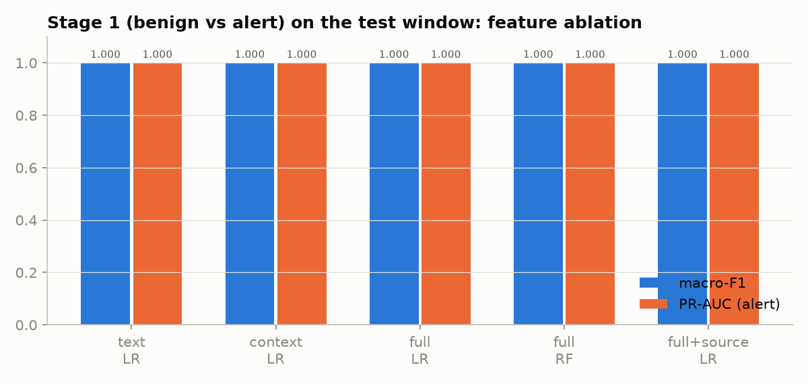
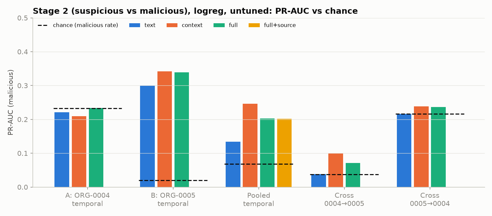
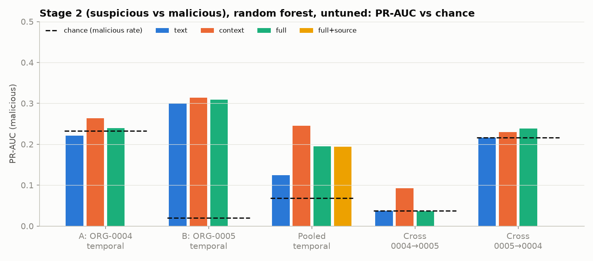
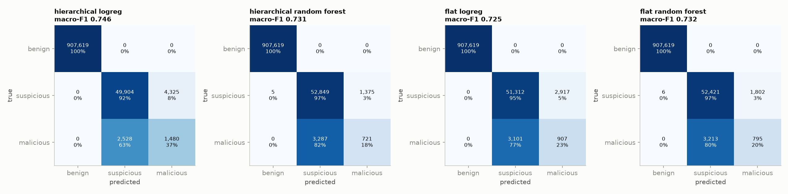

# Evidentia AI: Phase 2 ML Results

**Reproduce:**

```
.venv/Scripts/python scripts/train_models.py      # ~77 min on a 4-core i7-8550U, 16 GB RAM
.venv/Scripts/python scripts/results_figures.py
.venv/Scripts/python -m pytest -q tests            # 15 passed
```

**Where the numbers come from:** every number below is copied from `reports/metrics/{stage2,stage1,three_class,iforest}.json`. The full training log is `reports/metrics/train_log.txt` (no warnings). Models are saved in `models/` and listed in `models/registry.json`.

**What the labels mean:** they reproduce WitFoo Precinct's *automated* triage. They are not analyst-verified ground truth (dataset card).

---

## 1. Setup

| Item | Value |
|---|---|
| Task | Two stages:<br>• Stage 1: benign vs alert (all orgs)<br>• Stage 2: suspicious vs malicious (alert rows of ORG-0004/0005)<br>A flat 3-class model is trained for comparison. |
| Features | • TF-IDF on digit-masked message (20k word 1–2-grams)<br>• one-hot `message_type`, `action`, `protocol`, `severity`, `dst_port`, `src_port` bucket<br>• 23 **past-only** context features: event counts per src IP, dst IP, dst port, src→dst pair and src→port pair over 1 min / 10 min / 1 h / 6 h; seconds since the previous event from the same src IP; has-src/dst flags |
| Excluded | 14 post-label columns, source fields (`stream_name`, `product_name`, `vendor_name`, `pipeline`; used only in the ablation), `org_id`, `origin`, `timestamp_source`, `artifact_id`. Evidence: `reports/eda_summary.md` and chart `eda09`. |
| Leakage controls | • Every transform is inside a scikit-learn `Pipeline` fitted on training rows only.<br>• Context features count only strictly earlier events (unit-tested).<br>• Incidents that cross a cut-off are dropped from training (137 rows).<br>• Feature set, hyper-parameters and decision threshold are chosen by `StratifiedGroupKFold(3)` on the training window; groups = incident, or org + 2-hour block.<br>• The test window is scored once. |
| Imbalance | `class_weight="balanced"` (LR), `"balanced_subsample"` (RF); metrics are PR-AUC, macro-F1 and per-class recall |

**How the cut-offs were chosen.** The cut-offs were placed by looking at *when* malicious rows occur in the full capture (ORG-0004 2024-07-29 20:00 UTC, ORG-0005 2024-07-27 00:00 UTC), so that both sides contain incidents. This is a split-design decision, not tuning, but it did use the timing of test-period labels. It is disclosed here for that reason.

### Stage 2 split sizes

| Split | Train rows (malicious) | Test rows (malicious) | Chance PR-AUC |
|---|---|---|---|
| A: ORG-0004 temporal | 5,901 (1,063) | 13,390 (3,113) | 0.2325 |
| B: ORG-0005 temporal | 50,178 (2,518) | 44,777 (882) | 0.0197 |
| POOLED temporal (deployed) | 56,079 (3,581) | 58,167 (3,995) | 0.0687 |
| C: cross 0004 → 0005 | 19,291 (4,176) | 95,091 (3,536) | 0.0372 |
| C: cross 0005 → 0004 | 95,091 (3,536) | 19,291 (4,176) | 0.2165 |

---

## 2. Stage 1: benign vs alert

Test set: 965,856 rows of the test window at the natural class distribution (58,237 alerts). Training used all 56,147 training alerts plus 250,000 sampled benign rows.

| Features | Model | Macro-F1 | PR-AUC | Alert recall | False alerts | Train s | Inference ms / 1k rows |
|---|---|---|---|---|---|---|---|
| full | LR | 1.0 | 1.0 | 1.0 | 0 | 61.3 | 214.9 |
| full | RF | 1.0 | 1.0 | 0.9999 | 0 | 120.4 | 400.1 |
| text only | LR | 0.9999 | 1.0 | 0.9998 | 0 | 104.7 | 353.1 |
| context + categorical | LR | 1.0 | 1.0 | 1.0 | 0 | 11.6 | 7.8 |
| full + source | LR | 1.0 | 1.0 | 1.0 | 0 | 116.7 | 352.1 |



**Interpretation.** A perfect score here does **not** mean the model detects threats. Every feature set, including text-only and context-only, separates the classes perfectly. Adding source fields changes nothing because the task is already solved without them.

The EDA explains why:

- 99.77% of alert rows come from two log types (finding 3).
- Kept fields such as `dst_port` are populated for 1.45% of benign rows vs 97.78% of suspicious rows (finding 8).

So Stage 1 learns *which log format* the WitFoo rules fire on. It is useful as a router into Stage 2, but its score must be reported as **log-type recognition**.

### 2.1 Follow-up check: is Stage 1 still perfect inside one product?

Script: `scripts/stage1_within_product.py`. Output: `reports/metrics/stage1_within_product.json`.

**Question.** The obvious objection is "the model only recognises the product". The test is to remove the product shortcut by training and testing inside a single product. Same held-out future window as above; ≥10 rows of each class required in train and test.

**Which products can be tested.**

- **Testable:** only ASA Firewall, Windows Active Directory, Barracuda WAF and Falcon have both classes. ASA only just qualifies: 81 of its 95,143 rows are benign.
- **Not testable (16 product values, one of them blank):**
  - 13 have no alerts.
  - AWS VPC Security, Precinct and Symantec DLP have no benign rows.

| Product | Train alerts | Test rows | Test alerts | LR full | RF full | LR text | LR context |
|---|---|---|---|---|---|---|---|
| ASA Firewall | 50,165 | 44,822 | 44,761 | 1.0 | 1.0 | 1.0 | 1.0 |
| Windows Active Directory | 61 | 285,192 | 67 | 1.0 | 1.0 | 1.0 | 1.0 |
| Barracuda WAF | 13 | 920 | 16 | 1.0 | 1.0 | 1.0 | 1.0 |
| Falcon | 42 | 125 | 16 | 1.0 | 1.0 | 1.0 | 1.0 |

The model columns show PR-AUC (alert F1 is also 1.0 everywhere). Barracuda WAF and Falcon have very few alerts, so their rows are indicative only.

**Why it is still perfect.** The label is a deterministic function of the event type:

- There are 607 distinct `(product, message_type)` pairs across all 2,011,674 rows.
- **0** of them contain both benign and alert rows.
- **Examples:**
  - Windows AD: every alert is `auth_failure` (Logon), and no benign row has that type.
  - Barracuda WAF: `action = block` means alert, `GET`/`POST` means benign.
  - Falcon: `Crowdstrike Detection` means alert, `Asset Inventory` means benign.
  - ASA: `%ASA-4-106023` deny means alert, `%ASA-4-710003` means benign.

**Lookup-table baseline.** The baseline has no ML: it learns `(product, message_type) → majority label` on training rows, and any unseen pair → benign.

- It scores macro-F1 **1.0** on the 965,856 test rows.
- Only 4 alerts are missed. All 4 have a pair never seen in training (723 test rows have an unseen pair).

**Conclusion.**

- WitFoo's benign/alert split reproduces its own rule engine, which fires on event types.
- No model can score less than perfect, and none is needed. ML adds nothing here beyond robustness to unseen formats.
- Stage 1 is therefore presented as a **deterministic router**.
- The learning claim of this project rests on **Stage 2**: suspicious vs malicious *within the same event types*, where a lookup table cannot work.

---

## 3. Stage 2: suspicious vs malicious (the substantive task)

### 3.1 Feature ablation, untuned models (PR-AUC on the test window)

| Split | Chance | text LR | text RF | context LR | context RF | full LR | full RF | full+source LR | full+source RF |
|---|---|---|---|---|---|---|---|---|---|
| A ORG-0004 | 0.2325 | 0.2215 | 0.2215 | 0.2096 | 0.2631 | 0.2337 | 0.2394 | – | – |
| B ORG-0005 | 0.0197 | 0.2993 | 0.2993 | **0.3415** | 0.3138 | 0.3393 | 0.3092 | – | – |
| POOLED | 0.0687 | 0.1336 | 0.1248 | **0.2463** | 0.2456 | 0.2025 | 0.1948 | 0.2018 | 0.1937 |
| Cross 0004→0005 | 0.0372 | 0.0384 | 0.0372 | 0.1004 | 0.0922 | 0.0716 | 0.0364 | – | – |
| Cross 0005→0004 | 0.2165 | 0.2162 | 0.2165 | 0.2389 | 0.2293 | 0.2366 | 0.2385 | – | – |

ROC-AUC for the same runs:

| Split | text LR | context LR | full LR |
|---|---|---|---|
| B | 0.936 | 0.954 | 0.955 |
| POOLED | **0.416** | 0.878 | 0.791 |
| A | 0.373 | 0.445 | 0.505 |




### 3.2 Tuned models

Feature set, hyper-parameters and threshold were all chosen on the training window.

| Split | Model | Selected (by CV) | CV PR-AUC | Test PR-AUC | Test ROC-AUC | Threshold | Malicious P / R / F1 at threshold | Incidents detected | Size MB |
|---|---|---|---|---|---|---|---|---|---|
| **POOLED** | LR | context, C=0.1 | 0.4633 | **0.2502** | 0.8798 | 0.8539 | 0.256 / 0.367 / 0.301 | 514 / 622 (82.6%) | 0.01 |
| **POOLED** | RF | context, depth 20, leaf 5 | 0.4076 | **0.2571** | 0.8458 | 0.8399 | 0.344 / 0.181 / 0.237 | 545 / 622 (87.6%) | 2.72 |
| B ORG-0005 | LR | full, C=0.1 | 0.5296 | 0.3428 | 0.9550 | 0.9331 | 0.359 / 0.417 / 0.386 | 301 / 578 (52.1%) | 0.02 |
| B ORG-0005 | RF | context, depth None, leaf 5 | 0.4814 | 0.3181 | 0.9598 | 0.8775 | 0.350 / 0.762 / **0.479** | 520 / 578 (90.0%) | 1.90 |
| A ORG-0004 | LR | context, C=0.1 | 0.1560 | 0.2233 | 0.4648 | 0.9636 | 0 / 0 / 0 | 0 / 44 | <0.01 |
| A ORG-0004 | RF | context, depth None, leaf 5 | 0.1678 | 0.2754 | 0.5561 | 0.9057 | 0 / 0 / 0 | 0 / 44 | 1.51 |

**Tuning gains measured in CV (RF):** raising `min_samples_leaf` from 1 to 5 increased CV PR-AUC from 0.2072 to 0.3885 (POOLED, context, unlimited depth) and from 0.2818 to 0.4814 (ORG-0005, context). CV PR-AUC is higher than test PR-AUC in every split. Part of this comes from training-window bursts that resemble each other; the test window is the honest number.

### 3.3 What the Stage 2 results show

1. **ORG-0005: genuine but moderate signal on unseen future incidents.**
   - PR-AUC 0.32–0.34 against a chance level of 0.0197, about 17×; ROC-AUC ≈ 0.955.
   - The tuned RF finds at least one event in 90.0% of test incidents.
   - Malicious precision stays around 0.35, so roughly two of every three "malicious" flags are rows the engine left as suspicious.
2. **ORG-0004: no signal.** Test ROC-AUC is 0.46–0.56 and PR-AUC is about the chance level of 0.23. The CV score (0.16) already predicted this before the test was run.
   - Phase 1 found that 98% of ORG-0004's suspicious rows share source and destination IPs with malicious rows.
   - Which flow-log events the engine promoted to leads is therefore not explained by the event or its recent context. [Inferred]
3. **Cross-organization transfer fails.** All ROC-AUCs are between 0.31 and 0.55. As predicted in the audit, the two orgs use different log products (AWS VPC flow vs Cisco ASA).
   - Context features keep a little signal from 0004 → 0005 (PR-AUC 0.10 vs chance 0.037), but ROC-AUC is only 0.55.
4. **Context beats text when organizations are mixed.**
   - POOLED text-only ROC-AUC is 0.416, worse than random: text learned in one org's format points the wrong way in the other.
   - Context-only reaches 0.878.
   - CV selected context-only features for the deployed POOLED models.
   - This is the main evidence that the model learns *behavior* rather than log wording.
5. **Source fields add nothing in Stage 2:** full 0.2025 vs full+source 0.2018 PR-AUC (LR).
6. **"Novel text" subset.** 100% of Stage 2 test rows have exact message texts that never appear in training, because device timestamps and ports change the text. The novel-text metrics therefore equal the full-test metrics. Overlap of digit-masked *templates* between train and test was **not** measured; that would be the stricter check.
7. **Text-only LR and RF give identical PR-AUC** (0.2215 in A, 0.2993 in B). Digit-masked texts collapse into few templates (37 malicious templates in training), so both models rank the same groups of rows in the same order. [Inferred]

---

## 4. Three classes (benign / suspicious / malicious)

Test set: all 965,856 test-window rows (907,619 benign, 54,229 suspicious, 4,008 malicious).

| Strategy | Model | Accuracy | Macro-F1 | Benign F1 | Suspicious F1 | Malicious P / R / F1 |
|---|---|---|---|---|---|---|
| Hierarchical (stage 1 → stage 2, training threshold) | LR | 0.9929 | **0.7458** | 1.0 | 0.9357 | 0.255 / 0.369 / 0.302 |
| Hierarchical | RF | 0.9952 | 0.7313 | 1.0 | 0.9577 | 0.344 / 0.180 / 0.236 |
| Flat 3-class | LR | 0.9938 | 0.7254 | 1.0 | 0.9446 | 0.237 / 0.226 / 0.232 |
| Flat 3-class | RF | 0.9948 | 0.7317 | 1.0 | 0.9543 | 0.306 / 0.198 / 0.241 |



- **The hierarchical LR is best on macro-F1 and malicious recall.**
- **Accuracy (99.3–99.5%) is not meaningful** here: an all-benign predictor scores 94.0% on this test set.
- **Argmax diagnostic:** taking the argmax of the combined hierarchical probabilities would give macro-F1 0.7554 (LR) and 0.7617 (RF). This was computed on the test set as a diagnostic only and was **not** used to choose the decision rule.

---

## 5. Isolation Forest (unsupervised)

| Experiment | Fitted on | PR-AUC (chance) | ROC-AUC | At threshold: precision / recall of positive |
|---|---|---|---|---|
| Malicious vs suspicious among alerts | POOLED training alerts, labels unused | 0.2594 (0.0687) | 0.8787 | 0.287 / 0.247 (flags 5.9% of test) |
| Alert vs benign | 250k benign training rows only | 0.9986 (0.0603) | 0.9998 | 0.998 / 0.924 |
| Malicious vs everything else | same benign reference | 0.1552 (0.0041) | 0.9765 | 0.057 / 0.767 |

**Threshold rule:** the 99th percentile of anomaly scores on the training data. The model is 1.17 MB and trains in 3.5 s.

**Findings:**

- On the alert rows, the unsupervised detector ranks malicious rows about as well as the tuned supervised models: PR-AUC 0.259 vs 0.250 / 0.257.
- "Alert vs benign" is again largely log-type novelty.

**Disagreement with the tuned RF on the POOLED test alerts:**

| True label | RF malicious, IF normal | RF suspicious, IF anomaly | RF suspicious, IF normal | RF malicious, IF anomaly |
|---|---|---|---|---|
| malicious (3,995) | 721 | **987** | 2,287 | 0 |
| suspicious (54,172) | 1,366 | 2,443 | 50,354 | 9 |

The two detectors almost never flag the same rows: 0 malicious rows are flagged by both. The anomaly detector catches 987 malicious rows that the RF misses, at the cost of 2,443 extra suspicious flags. This is why the orchestrator reports both outputs and their disagreement instead of merging them.

---

## 6. ML orchestrator (`evidentia/ml/orchestrator.py`)

For each event the orchestrator returns:

- The class, the 3-class probabilities, p(alert) and p(malicious | alert) from **both** LR and RF.
- The decision rule, plus a warning that the probabilities are not calibrated (class-balanced training).
- A model-agreement flag.
- The anomaly score and flag, kept separate from the probabilities. The Isolation Forest was fitted on alert rows only, so it scores only in-domain rows that at least one Stage 1 model routes to the alert stage. Other rows return `scored: false`.
  - **Bug found and fixed:** the first version scored every row. On the 20-minute sample it flagged 14,378 of 17,363 rows, almost all of them benign. After the fix it flags 2.
- Free-text notes, e.g. "anomaly detector flags this event although both classifiers predict benign".
- The label semantics.
- The model and feature versions.

**Applicability gate.** A record is scored as in-domain only if it has a timestamp and at least 30% of its word *bigrams* are in the training vocabulary. A record without text needs a known `message_type` instead.

- **Calibration on 20,000 held-out test rows:** 1st percentile 0.333, 5th percentile 0.857.
- **Other text** scored 0.0–0.1: a browser-history line, a web-server access line, an incident-report sentence, an OCR string.
- **Bug found and fixed:** the first version used single words and wrongly accepted the browser-history line (coverage 0.75). The unit test `test_orchestrator_on_unseen_records` caught it.

---

## 7. Answers to the project questions

- **Does it work on unseen data?**
  - **Within ORG-0005, on future, unseen incidents: yes, partly.** ROC-AUC 0.955, PR-AUC 17× chance, 90% of incidents touched.
  - **Within ORG-0004: no.**
  - **Across organizations: no.**
  - **On non-security artifacts** (browser history, screenshots, reports): not applicable by design; the gate refuses them.
- **Is "intelligent" justified?** Partly, and for a specific reason. The deployed models chose *behavioral context* over text, and that context is what generalizes inside an organization. The Isolation Forest adds an independent, label-free view that catches different malicious rows. The supervised models do **not** reproduce the WitFoo engine with high precision: malicious precision is about 0.26–0.36.
- **LR vs RF.**
  - Ranking quality is comparable (PR-AUC 0.250 vs 0.257 POOLED).
  - LR has higher malicious recall at its threshold and the best 3-class macro-F1 (0.746).
  - LR is about 190× smaller (14 KB vs 2.7 MB on disk) and about 4× faster at inference (3.6 vs 14.7 ms per 1k rows).
  - RF touches more incidents (87.6% vs 82.6%).

## 8. Limitations

- Labels come from an automated engine, with no analyst ground truth.
- ORG-0005, ORG-0003 and ORG-0001 cover about 0.78 days each, and ORG-0004 about 5.78 days. Each temporal test is one burst pattern.
- Malicious precision of about 0.3 means most "malicious" flags would still need analyst review.
- CV PR-AUC is consistently above test PR-AUC.
- Cut-offs were placed using the timing of malicious rows (disclosed in §1).
- Template overlap between train and test was not measured.
- Probabilities are uncalibrated.
- `incident_signals` was not used; the ablation that includes it was not run.
