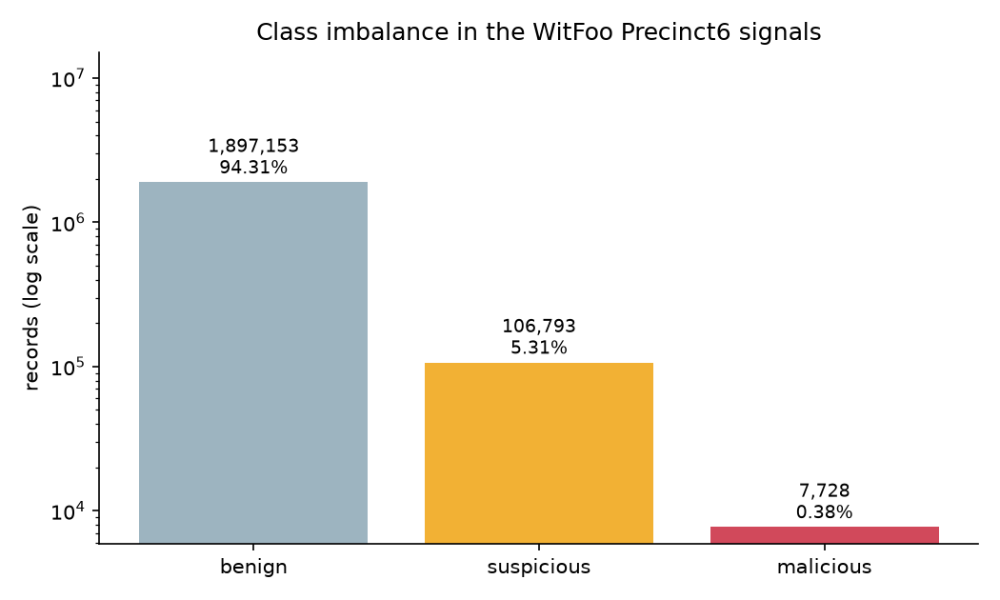
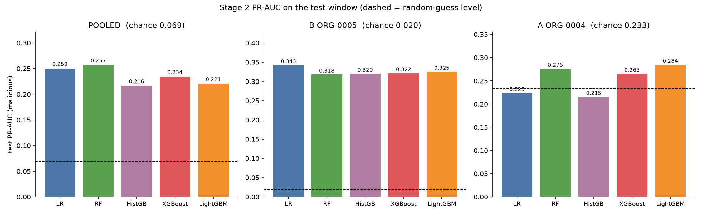
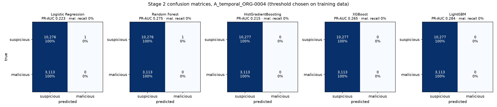
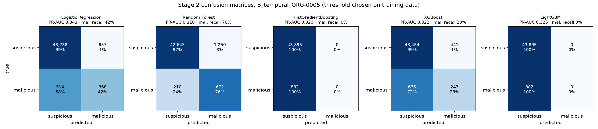
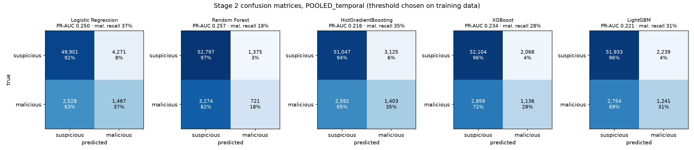
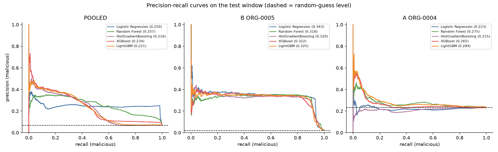
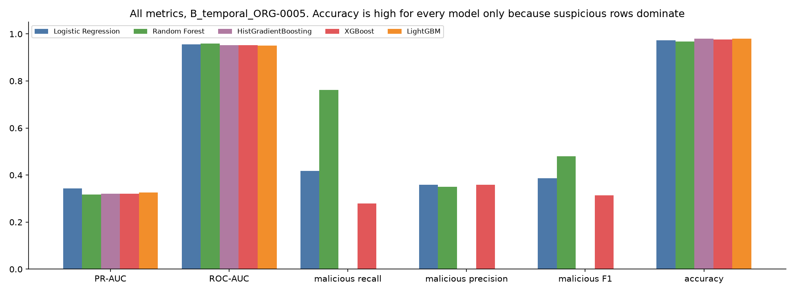
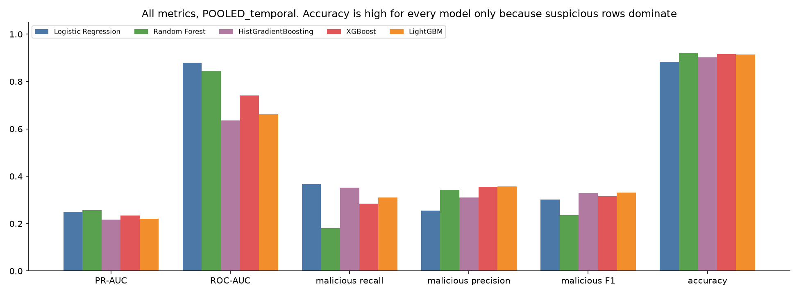

# Stage 2 model comparison (separate experiment)

Generated by `scripts/compare_models.py`. Does not change `models/` or any existing metric file.

Task: suspicious (0) vs malicious (1) among alert rows. Same rows, splits, features and leakage rules as the main pipeline. Feature set, hyper-parameters and threshold chosen by StratifiedGroupKFold on the training window; test window scored once. HistGradientBoosting uses the context feature set only (it cannot take sparse TF-IDF).

## Class imbalance

| Class | All rows | Share |
|---|---|---|
| benign | 1,897,153 | 94.31% |
| suspicious | 106,793 | 5.31% |
| malicious | 7,728 | 0.38% |

| Split | Train rows | Train malicious | Test rows | Test malicious |
|---|---|---|---|---|
| POOLED_temporal | 56,079 | 3,581 | 58,167 | 3,995 |
| B_temporal_ORG-0005 | 50,178 | 2,518 | 44,777 | 882 |
| A_temporal_ORG-0004 | 5,901 | 1,063 | 13,390 | 3,113 |

## POOLED_temporal

| Model | Features (CV) | CV PR-AUC | Test PR-AUC | Chance | Test ROC-AUC | Mal. precision | Mal. recall | Mal. F1 | Macro-F1 | Accuracy | Tuning s |
|---|---|---|---|---|---|---|---|---|---|---|---|
| Logistic Regression | context | 0.4633 | **0.2503** | 0.0687 | 0.8798 | 0.2557 | 0.3672 | 0.3014 | 0.6188 | 0.8831 | 30.9 |
| Random Forest | context | 0.4076 | **0.2571** | 0.0687 | 0.8458 | 0.344 | 0.1805 | 0.2367 | 0.5973 | 0.9201 | 161.7 |
| HistGradientBoosting | context | 0.1924 | **0.2164** | 0.0687 | 0.6365 | 0.3098 | 0.3512 | 0.3292 | 0.6381 | 0.9017 | 190.9 |
| XGBoost | context | 0.2265 | **0.2345** | 0.0687 | 0.7404 | 0.3546 | 0.2844 | 0.3156 | 0.6352 | 0.9153 | 59.3 |
| LightGBM | context | 0.2213 | **0.2207** | 0.0687 | 0.6617 | 0.3566 | 0.3106 | 0.332 | 0.6431 | 0.9142 | 50.1 |

Highest test PR-AUC: **Random Forest** (0.2571). Selected parameters: Logistic Regression {'clf__C': 0.1}; Random Forest {'clf__max_depth': 20, 'clf__min_samples_leaf': 5}; HistGradientBoosting {'clf__l2_regularization': 0.0, 'clf__max_leaf_nodes': 15}; XGBoost {'clf__max_depth': 4, 'clf__min_child_weight': 5}; LightGBM {'clf__min_child_samples': 100, 'clf__num_leaves': 15}

## B_temporal_ORG-0005

| Model | Features (CV) | CV PR-AUC | Test PR-AUC | Chance | Test ROC-AUC | Mal. precision | Mal. recall | Mal. F1 | Macro-F1 | Accuracy | Tuning s |
|---|---|---|---|---|---|---|---|---|---|---|---|
| Logistic Regression | full | 0.5296 | **0.3429** | 0.0197 | 0.955 | 0.359 | 0.4172 | 0.3859 | 0.6863 | 0.9738 | 27.7 |
| Random Forest | context | 0.4815 | **0.3181** | 0.0197 | 0.9598 | 0.3496 | 0.7619 | 0.4793 | 0.7312 | 0.9674 | 134.1 |
| HistGradientBoosting | context | 0.2719 | **0.3203** | 0.0197 | 0.9529 | 0.0 | 0.0 | 0.0 | 0.495 | 0.9803 | 151.5 |
| XGBoost | full | 0.2907 | **0.3216** | 0.0197 | 0.9529 | 0.359 | 0.28 | 0.3146 | 0.6512 | 0.976 | 44.4 |
| LightGBM | full | 0.2784 | **0.3254** | 0.0197 | 0.9505 | 0.0 | 0.0 | 0.0 | 0.495 | 0.9803 | 48.3 |

Highest test PR-AUC: **Logistic Regression** (0.3429). Selected parameters: Logistic Regression {'clf__C': 0.1}; Random Forest {'clf__max_depth': None, 'clf__min_samples_leaf': 5}; HistGradientBoosting {'clf__l2_regularization': 1.0, 'clf__max_leaf_nodes': 15}; XGBoost {'clf__max_depth': 4, 'clf__min_child_weight': 5}; LightGBM {'clf__min_child_samples': 20, 'clf__num_leaves': 15}

## A_temporal_ORG-0004

| Model | Features (CV) | CV PR-AUC | Test PR-AUC | Chance | Test ROC-AUC | Mal. precision | Mal. recall | Mal. F1 | Macro-F1 | Accuracy | Tuning s |
|---|---|---|---|---|---|---|---|---|---|---|---|
| Logistic Regression | context | 0.156 | **0.2233** | 0.2325 | 0.4648 | 0.0 | 0.0 | 0.0 | 0.4342 | 0.7674 | 2.3 |
| Random Forest | context | 0.1678 | **0.2754** | 0.2325 | 0.5561 | 0.0 | 0.0 | 0.0 | 0.4342 | 0.7674 | 15.4 |
| HistGradientBoosting | context | 0.1426 | **0.2148** | 0.2325 | 0.4691 | 0.0 | 0.0 | 0.0 | 0.4342 | 0.7675 | 45.6 |
| XGBoost | context | 0.147 | **0.2645** | 0.2325 | 0.5166 | 0.0 | 0.0 | 0.0 | 0.4342 | 0.7675 | 20.5 |
| LightGBM | context | 0.139 | **0.2842** | 0.2325 | 0.5538 | 0.0 | 0.0 | 0.0 | 0.4342 | 0.7675 | 15.5 |

Highest test PR-AUC: **LightGBM** (0.2842). Selected parameters: Logistic Regression {'clf__C': 0.1}; Random Forest {'clf__max_depth': None, 'clf__min_samples_leaf': 5}; HistGradientBoosting {'clf__l2_regularization': 0.0, 'clf__max_leaf_nodes': 15}; XGBoost {'clf__max_depth': 8, 'clf__min_child_weight': 5}; LightGBM {'clf__min_child_samples': 100, 'clf__num_leaves': 63}

## Figures

